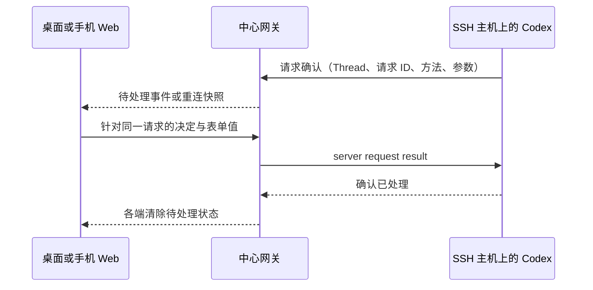

# Web 自托管工作区

浏览器向同源中心服务登录，选择账号拥有的 SSH 主机和远程绝对目录，再由 openWorkspace 装配 ZCode 的 RemoteServiceAccess。模型和历史以选中主机的 Codex app-server 为准。真实 Thread ID 同时用于浏览器地址和会话操作。关闭浏览器只注销订阅。添加、编辑主机及项目由服务端持久化，响应不包含 SSH 私钥和口令。

Web 入口是 index.ts。协议类型位于 contract.ts，运行模块位于本目录。公共界面继续由 ZCode Root 提供。

项目归属、写锁冲突、历史分页和首轮命名以 [自托管会话规格](../../../../specs/selfhost-codex/README.md) 为准。

自托管的现有 TaskService/Controller 会话删除命令调用远端 `thread/delete`。只有显式确认且目标属于仍挂载的工作区时才提交，执行前读原生状态拒绝正在运行的目标。Codex 拥有历史存在性。中心账号组织服务拥有未读标记与置顶，浏览器从目录与定点查询读取投影。原生删除通知按验证后的 SSH Host 与原生 Thread 处理，切换主机不复用先前的操作或缓存。见[会话操作与设置兼容性](../../../../specs/selfhost-codex/README.md#会话操作与设置兼容性)。

个性化复用 SettingService 的编辑器。Codex 用户目录由已认证 SSH worker 解析，保存携带先前所读内容和实际路径，远端锁内比对并原子写回，浏览器不能指定写入其他文件。

输入图片以已认证的 SSH 主机为上传目标。浏览器的 AttachmentBridge 按 uploadId 持有分片事务，新任务用现有草稿标记接入同一上传队列。Codex 持有已发送消息和历史图片。SessionBridge 查验当前 Thread 后通过该主机的文件服务读取本地图片，或在浏览器内按偏移解码内嵌图片。HTTP(S) 图片复用会话来源的外部打开入口。参见 [输入图片和历史预览](../../../../specs/selfhost-codex/README.md#输入图片和历史预览)。

连接异常以 [连接异常提示](../../../../specs/selfhost-codex/README.md#连接异常提示) 为准。模型恢复和最终失败随当前 Thread 投影，WebSocket 连接和 SSH 主机生命周期随工作区展示。

## 工作区、登录账号与审批

远端 Thread 响应允许上游增加展示层未使用的顶层元数据。网关只投影已知字段，继续校验会话 ID、状态和已使用的字段。强制同步读取远端实际数据，格式确实不兼容时向用户显示简短的字段错误。使用两种 CLI 版本验证项目发现、会话列表与恢复。

SSH 目录从项目侧栏顶部的当前主机打开，每台主机提供进入、编辑、删除和打开目录。具体项目在工作区侧栏显示。进入主机时上次使用的目录属于该主机且仍已登记时优先恢复，其次使用已登记的项目，首次连接无项目时使用该 SSH 用户的家目录。切换主机、目录和 Thread 时沿用已有身份与路由。测试草稿、取消、重试和子智能体详情遵循[自托管规格](../../../../specs/selfhost-codex/README.md#ssh-主机配置测试与切换)。

主机配置持有工作区显示名和头像。头像字段接受 Font Awesome 类名及可选前景色、旧版内置图标或 PNG 缩略图。浏览器将旧图标名映射到当前图库，默认显示服务器图标。头像和名称随同一主机的配置一起保存并广播，工作区侧栏、手机设备栏和管理卡片读取同一记录。左下角菜单展示网页登录账号，并提供账号设置。

登录用户可在「账号设置」凭当前密码修改中心用户名、密码或两者。账号 ID 及关联数据保留，用户名继续使用现有规范化规则。服务端在同一事务核对旧密码、更新凭据、撤销既有令牌。操作成功后，各端重新登录。失败保留原凭据与会话，重复用户名返回可操作的错误。

`GET /api/auth/me` 提供账号头像，`PATCH /api/selfhost/account/avatar` 接受账号图片缩略图或 `null`。浏览器以当前登录连接为作用域持有一份账号展示值，保存后的服务端响应更新该值。Gateway 以认证账号为唯一持久化所有者。SSH 主机名、头像和 SSH 用户从主机配置读取。

MCP 确认、表单及 URL 请求按原方法、请求 ID 与所属远端 Thread 路由。界面展示服务器和请求消息，支持接受、拒绝和取消。接受表单时按 schema 收集有类型的值，URL 模式由用户主动打开安全的网页地址。客户端只显示远端实际仍待处理的请求，提交失败可重试，另一端已处理的请求随远端事件消失。原生时间线有时只保留已落盘的轮次。中心以现有的待答请求注册表保存仍有效的请求载荷，重连快照从此注册表恢复，RPC 连接终止时清理。终端命令与文件审批保持各自的响应结构。

终端命令的理由、预览和原生决定遵循[终端命令审批规格](../../../../specs/selfhost-codex/README.md#终端命令审批)。`SessionBridge` 从同一待答请求重建有效决定，按选项 ID 取回对应的原生响应。

Gateway 的待答注册表以账号、主机、Thread、连接世代和保留原类型的请求 ID 路由。激活响应以 `pendingRequests` 提供待答请求，实时订阅以 `serverRequest.requested` 与 `serverRequest.resolved` 按序更新。多个请求可以指向同一原生条目。无轮次请求以 Thread 为锚点。物理 RPC 连接最多接纳一个响应，远端 `resolved` 确认清场，工具的执行结果单独由 `item/completed` 决定。

验收使用独立测试账号和受控的 MCP 请求，覆盖桌面与手机宽度、旧主机默认图标、主机名与头像跨端同步、账号冲突与旧凭据失效、表单和 URL 响应，以及关闭首个客户端后在第二个客户端完成审批。普通文本、显式附件和 Plan 选项分别对照 Codex 的实际协议载荷。

## SSH 工作区服务生命周期

页面挂载的服务以登录连接、主机登记身份、SSH 端点和目录为身份。路由切换时同步核对身份。模型目录失败保留远端文件和可读会话。已展开目录在浏览器或 SSH 恢复后申请新租约，终端在 WebSocket 重连时核对 Gateway 保存的 PTY，再接受输入。定时任务按已验证的主机和任务选定的目录执行。主机被替换后保留定义并暂停，重新绑定后才能执行。
