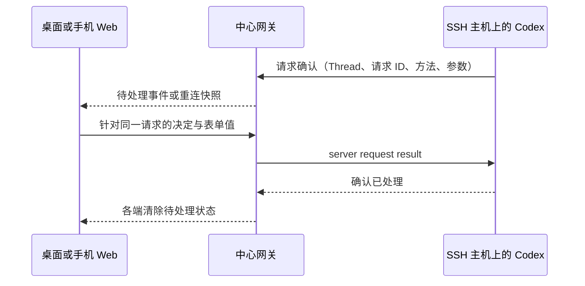

# Web 自托管工作区

浏览器向同源中心服务登录，选择账号拥有的 SSH 主机和远程绝对目录，再由 openWorkspace 装配 ZCode 的 RemoteServiceAccess。模型和历史以选中主机的 Codex app-server 为准。真实 Thread ID 同时用于浏览器地址和会话操作。关闭浏览器只注销订阅。添加、编辑主机及项目由服务端持久化，响应不包含 SSH 私钥和口令。

Web 入口是 index.ts。协议类型位于 contract.ts，运行模块位于本目录。公共界面继续由 ZCode Root 提供。

## 工作区、登录账号与审批

远端 Thread 响应允许上游增加展示层未使用的顶层元数据。网关只投影已知字段，继续校验会话 ID、状态和已使用的字段。强制同步读取远端实际数据，格式确实不兼容时向用户显示简短的字段错误。使用两种 CLI 版本验证项目发现、会话列表与恢复。

SSH 管理页以主机为单位，每张卡提供进入、编辑、删除和打开目录。具体项目在工作区侧栏显示。进入主机时上次使用的目录属于该主机且仍已登记时优先恢复，其次使用已登记的项目，首次连接无项目时使用该 SSH 用户的家目录。切换主机、目录和 Thread 时沿用已有身份与路由。

主机配置持有工作区显示名和头像。旧配置默认显示服务器图标，可以选择内置图标或上传图片。头像和名称随同一主机的配置一起保存并广播，工作区侧栏、手机设备栏和管理卡片读取同一记录。左下角菜单可直接编辑当前工作区，并可单独打开登录账号设置。登录账号与主机、SSH 用户分别展示。

登录用户可在「账号设置」凭当前密码修改中心用户名、密码或两者。账号 ID 及关联数据保留，用户名继续使用现有规范化规则。服务端在同一事务核对旧密码、更新凭据、撤销既有令牌。操作成功后，各端重新登录。失败保留原凭据与会话，重复用户名返回可操作的错误。

MCP 确认、表单及 URL 请求按原方法、请求 ID 与所属远端 Thread 路由。界面展示服务器和请求消息，支持接受、拒绝和取消。接受表单时按 schema 收集有类型的值，URL 模式由用户主动打开安全的网页地址。客户端只显示远端实际仍待处理的请求，提交失败可重试，另一端已处理的请求随远端事件消失。原生时间线有时只保留已落盘的轮次。中心以现有的待答请求注册表保存仍有效的请求载荷，重连快照从此注册表恢复，RPC 连接终止时清理。终端命令与文件审批保持各自的响应结构。

验收使用独立测试账号和受控的 MCP 请求，覆盖桌面与手机宽度、旧主机默认图标、主机名与头像跨端同步、账号冲突与旧凭据失效、表单和 URL 响应，以及关闭首个客户端后在第二个客户端完成审批。普通文本、显式附件和 Plan 选项分别对照 Codex 的实际协议载荷。
