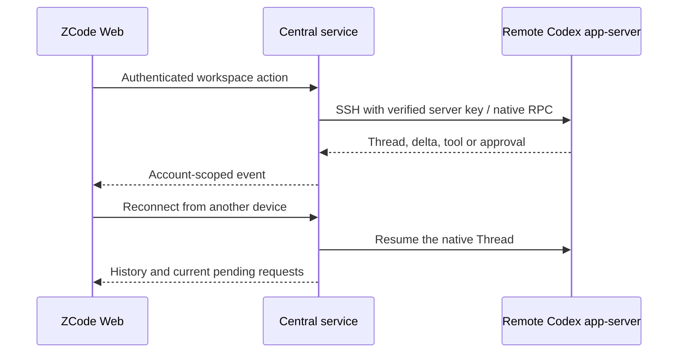

# Self-hosted SSH Codex

ZCode owns the Web interface for desktop and phone. The authenticated central service owns host definitions, trusted SSH host keys, project navigation and browser event fan-out. The selected SSH account owns its Codex process, files, Git work tree, PTYs and persistent native Threads.

Acceptance includes a real model list and reasoning control, native prompt editor with draft retention, original layout at desktop and phone widths, independent browser login, real model/tool/approval events, history after reconnect, remote Git/files/PTY, host key mismatch, and persistent server configuration. Commercial service endpoints are excluded from the self-host build. The external deployment port is 33723.
