# Self-hosted SSH Codex

ZCode owns the Web interface for desktop and phone. The authenticated central service owns host definitions, trusted SSH host keys, project navigation and browser event fan-out. The selected SSH account owns its Codex process, files, Git work tree, PTYs and persistent native Threads.

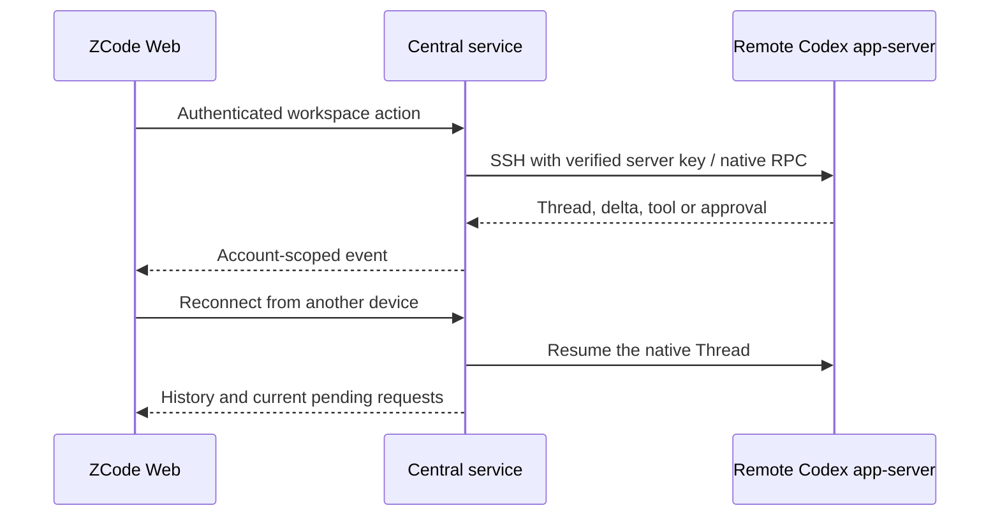

Acceptance includes a real model list and reasoning control, native prompt editor with draft retention, original layout at desktop and phone widths, independent browser login, real model/tool/approval events, history after reconnect, remote Git/files/PTY, host key mismatch, and persistent server configuration. Commercial service endpoints are excluded from the self-host build. The external deployment port is 33723.

## SSH 主机上的应用管理

桌面与手机在工作区侧栏提供同一个「扩展」入口。「插件 / 应用 / 技能」是该页面唯一一层能力分类，默认打开当前 SSH 主机的固定已安装插件视图。浏览市场、打开具体插件和添加来源直接到原有 ZCode 商店对应视图，返回后继续管理已安装插件。已安装目录先可操作，搜索、详情和就绪状态取自当前远端；可用条目的「使用」在同一项目创建带引用的可编辑草稿。MCP 继续从设置进入，普通插件设置沿用已有分类标签。

导航依据是 [DeepSeek Harness 的插件页](https://github.com/deepseek-ai/deepseek-harness/blob/4b399c39a6d1479cd84ca591b4d7c88e24d38a96/packages/client/ui-plugin-manager/src/client/PluginManagerPage.tsx) 与[按 Host 返回的账号操作](https://github.com/deepseek-ai/deepseek-harness/blob/4b399c39a6d1479cd84ca591b4d7c88e24d38a96/packages/client/ui-connector-account/README.zh.md)。已安装项优先、进入聊天再选取的交互也参考了 [goose 的侧栏与会话扩展](https://goose-docs.ai/docs/getting-started/using-extensions/)，技能来源可查参考了 [OpenCode 的项目与个人技能](https://opencode.ai/docs/skills/)。Codex 配置及作用域取自 [OpenAI 配置参考](https://learn.chatgpt.com/docs/config-file/config-reference)。

在设置的「Agent 能力」中，应用、插件、技能使用独立入口。应用管理沿用 ZCode 商店的分段、搜索和新任务草稿交互。默认查看当前 SSH 主机上 Codex 返回的「已安装」应用，打开「浏览应用」后才分页读取整个目录。已有运行快照优先显示，原生冷缓存为空或用户刷新时再向远端刷新。账号连接从 Codex 返回的 HTTPS 地址进入。详情可查看工具及所属插件，可调用的应用提供「在新对话中使用」，生成当前工作区可编辑的应用引用草稿，由用户发送。

原生 `app/installed` 拥有已安装、有效开关和可调用状态。输入框使用现有原生 Thread 的配置快照，新任务读取全局快照。只有远端缺少 `app/installed` 方法时才按游标读取 `app/list` 中明确可访问且启用的条目。目录故障不阻塞已安装列表，单个详情或图标缺失时保留已知的运行状态。ZCode 商店的交互参照 [`PluginStoreListView`](https://github.com/zai-org/ZCode/blob/a4b4445141eb7d3b3e99eada9292775383bfc44e/packages/ui/src/settings/PluginStoreListView.tsx) 和 [`PluginStorePage`](https://github.com/zai-org/ZCode/blob/a4b4445141eb7d3b3e99eada9292775383bfc44e/packages/ui/src/settings/PluginStorePage.tsx)，协议参照 [Codex Apps](https://learn.chatgpt.com/docs/app-server#apps-connectors)。

应用开关将一个应用 ID 和布尔值提交到已认证主机，经限定操作写入 `apps.<id>.enabled`。单工具开关只写该应用的相应工具，配置服务处理策略覆盖。写完重新读取远端有效状态。浏览器不能从这个接口指定任意配置键或文件。点击应用详情不启动工具，也不自动向服务商授权。

`app/read` 返回服务商公布的工具信息。工具开关另外读取 Codex 的有效配置 `config/read`，单工具的 `tools.<name>.enabled` 优先于应用的 `default_tools_enabled`，仅向页面返回该条目的状态。服务商禁用的工具保留原因。若暂时读不到配置，详情仍可查看，工具开关提示读取失败并允许重试。

空目录通过原生 `account/read` 与 `config/read` 区分未登录 ChatGPT、API Key 登录、显式关闭 Apps 和确无条目的情况。前两种给出目标主机上的设备登录命令，显式关闭时给出原生启用命令。Gateway 只向页面传递原因，用户自行决定是否更改该主机的登录或配置。

| 验收 | 场景 | 通过条件 |
| --- | --- | --- |
| SH-APP-MANAGEMENT | 两台主机、目录多页、未连接/已禁用/已连接但不可调用的应用、旧版本缺少运行态接口 | 桌面与手机从设置找到三类入口；按 ID 合并并区分状态，连接打开原生链接，详情显示该应用的工具，主机切换隔离旧响应。 |
| SH-APP-WRITE | 启用或禁用应用及单个工具，策略覆盖或配置写失败 | 远端收到单个原生配置叶子的修改。覆盖或失败在页面可见，另一个应用及其他权限配置保留。 |
| SH-APP-INVOKE | 首屏有已安装项，目录慢或失败；从设置打开可用应用，从聊天输入框选择应用 | 首屏与聊天选择不依赖市场请求。打开可用应用后可预填新任务；已停用或无可用工具的应用不能作为可用候选。远端 Turn 同时收到 `$` 文本与指向原生应用 ID 的 `app://` 引用。 |
| SH-EXTENSIONS-ENTRY | 桌面和手机从项目侧栏打开扩展，切换三类列表，进入市场查看来源并返回，最后从「使用」回到聊天 | 三类资源共用一层分类，当前选中项与列表相符。已安装项先呈现，进入市场才读取账号目录。点击使用后当前项目的草稿保留可删除的引用，用户发送前无新 Turn。 |

手机列表与聊天各自有导航状态。只有当前工作区准备好用户请求的预填草稿后，手机才从列表进入聊天；先打开扩展、浏览详情、切换其他主机都不应打开聊天。重挂载编辑器从同一个草稿读取结构化引用和正文。

从 A 的扩展页选择项目 B 的技能时，Web 按选中主机核对 B 的注册目录，切换至 B 的工作区服务，再由 B 的 Root 接收原生技能引用和草稿。主机被替换、目录被移走或期间用户改选项目时，放弃这次交接。

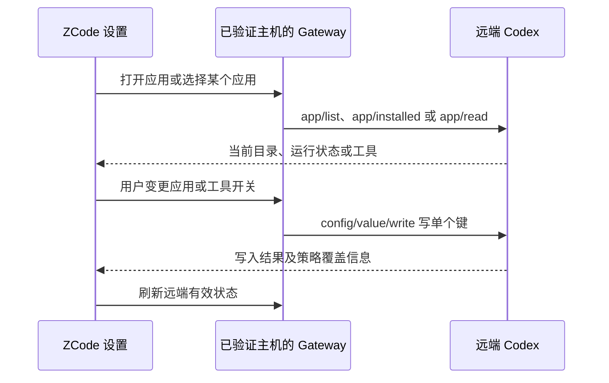

参见 [App Server 应用与配置协议](https://learn.chatgpt.com/docs/app-server#apps) 和 [Codex 应用配置项](https://learn.chatgpt.com/docs/config-file/config-reference)。

## 原生协议与工作区验收

每个 Web 工作区的服务归已验证的 SSH 主机和目录所有。浏览器只投影原生事实，Gateway 按账号、主机、Thread 和连接世代路由。桌面和手机 Web 使用同一可回放订阅，原生 Electron 的连续投递仍走窗口 Host。

| 场景 | 已复现的触发条件 | 所有者、接口和通过条件 |
| --- | --- | --- |
| SH-TARGET | 在相同路径的两台主机间切换，或在 A 项目新建指向 B 的自动化 | 工作区只挂载匹配当前主机与目录的服务。调度持久化所选项目，在领取和派发时校验主机身份。替换连接身份后原任务暂停，配置与历史可查。 |
| SH-HISTORY-FORMAT | 打开 legacy、分页历史、其他写者或提供商不匹配的 Thread | Codex 持有读写资格。legacy 按轮次游标读取，分页历史沿用时间线。写者冲突或提供商不兼容时历史可读。新会话尚未落盘时复用已接纳的原生订阅。 |
| SH-REPLAY | 激活与订阅之间完成一轮、仅 SSH 断开、快照读取途中出现增量、上翻跨页长轮 | Gateway 给出与快照内容一致的回放边界，Web 按订阅世代及有序事件 ID 应用增量。恢复后文字完整、终态稳定、用户行位置稳定。失败保留已读内容并可重试。 |
| SH-SEND | 创建成功或首轮接纳后丢回执、忙时带图引导、顺序完成 65 个上传 | 先绑定真实 Thread ID，再发送首轮。已发但未确认时按原生用户行的 clientId 查账，缺乏正向证据保留待确认输入。输入引用一致进入 start 或 steer。上传完成释放活跃配额，同一上传 ID 的完成回执可重读。 |
| SH-INTERACTIONS | 同命令多个审批、两端同时决定、同题面不同题目 ID、无轮次的 MCP 表单 | 原生请求 ID 独立清场。显示真实命令、主机、范围和期限。问题按 ID 回答，支持跳过、部分答案和掩码输入。拒绝或失败保留真实结果，无轮次请求不产生可控制的活动轮次。 |
| SH-LIST-SHARE | 同时查询两个目录、按创建时间排序、归档后恢复、在 600 条 Thread 中查询已知 ID 与目录预览、分享跨页选择 | 原生项目及归档状态和账号置顶各有单一所有者。已知 ID 定点或批量读取，目录预览仅读首个原生页，同范围并发查询复用。需要精确总数时完成分页。分享预检与发布使用同一组所选原生轮次，缺少一轮即报告。 |
| SH-CATALOG | 旧 Thread 使用另一提供商、模型目录失败、加号中选择同名 Skill 或插件、MCP 发现失败或要求重新认证 | 目录按主机、目录及 Thread 提供商选择。目录故障独立于历史和文件。选中的原生 skill/mention 随最终输入发送。MCP 设置及工作流文件管理复用已注册服务。两条 MCP 状态查询共用 Codex 运行状态、认证及工具发现结果。旧响应仍能凭已初始化服务或工具返回连接状态。 |
| SH-REMOTE-IO | 已展开目录的 SSH 通道中断、网页断线期间 PTY 退出 | 以 SSH 世代重新建立所需文件监听并补读。WebSocket 恢复时核对该账号已知 PTY，保留仍活跃的会话并报告已退出的终端。 |
| SH-NATIVE-CONTROLS | 运行时排队、刷新后取消、从选中已完成轮创建分支、触发压缩 | 原生队列持有接受顺序，Web 回读并按队列 ID 取消。从已完成轮指定边界创建子 Thread。上下文用量及压缩进度来自原生事件；主机能力决定入口。 |
| SH-STATUS | 官网示例宽度下有 Git、Goal、计划、子智能体和来源，切换会话及屏幕宽度 | 自托管桌面在空间足够时默认展开可折叠的右上面板，窄屏用右上按钮，手机用抽屉。各节使用当前工作树或 Thread 的真实数据。 |
| SH-TURN-FILES | 两轮修改不同文件、同一路径被再次编辑、预览后外部修改或执行中断 | 每轮展示原生 Turn 的文件、净增删和补丁。SSH 工作进程按确证的前后内容及有效工作区验证整批撤销，冲突标出文件，保护后续修改、暂存区与历史。可恢复的事务按操作 ID 对账。 |
| SH-REWIND-MAC | SSH 进程把普通文件移入私有事务目录后，macOS 自动更新同一 inode 的系统来源属性 | 移动前核对全部元数据；仅对事务自己移动的同一文件接受系统来源属性更新，核对原件身份、内容、权限、用户组和其他扩展属性。失败恢复文件并显示原因。 |
| SH-ALIAS-FIRST | Mac 上从目录别名首发，原生接纳时项目列表尚未收录，首轮需要审批 | 原生创建和发送回执确定目标 Thread 后立即从草稿进入该会话。目录和分组读模型随后刷新。文件凭据、自动化目标按 SSH 主机解析的真实目录核对。 |
| SH-RELEASE-RETRY | 新容器替换了健康 A 后首次等待失败，再次更新到 B | 发布目录在替换前记录并保留 A 的镜像 ID。重试后 B 活跃、A 可回退；功能验收后才清理本项目未引用的旧镜像和临时归档。 |

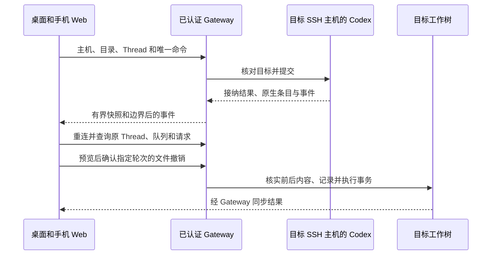

## 输入框应用、插件和技能

桌面和手机 Web 都从输入框的加号选择应用、插件和技能。输入 `$` 可搜索应用和技能，输入 `@` 可搜索插件及原有的文件与会话引用。点击候选或用键盘确认后，在同一草稿的光标位置插入标签。加号中三个分组末尾分别提供管理入口，打开当前 SSH 工作区内对应的扩展页面。用户可返回原草稿继续编辑。选择可重复撤销，只有发送动作才提交给 Codex。

应用目录来自当前 SSH 主机。已有会话按 Codex Thread 查询其可用应用，新任务按当前主机查询。当前版本提供运行时快照时，候选是可调用的已启用应用。只支持 `app/list` 的版本以目录中同时可访问且启用的条目为准。已有 Thread 未加载时显示原生读取失败，不切换到主机全局结果。应用目录为空时，`+` 和 `$` 指向「扩展 → 应用」。插件读取已安装摘要，技能从当前 SSH 工作目录的 `skills/list` 获取。三组各自显示加载和读取失败。候选采用原生展示名称，同名插件附市场，同名技能附来源和路径。

草稿继续使用可复制、可恢复的引用文本，已有编辑器草稿快照在刷新后恢复可编辑的标签。提交路径复用同一个原生 UserInput 构造器，将引用转为文本标记及结构项。App 发送按 Codex 的名称规则生成的 `$slug` 与 `mention`（`app://<id>`）。插件发送 `@name` 与 `mention`（`plugin://<name>@<marketplace>`）。技能发送 `$name` 与 `skill`（原生名称和绝对 `SKILL.md` 路径）。同一引用多次出现在正文时保留各位置，结构引用按目标去重。原生文本的 `text_elements` 携带 UTF-8 字节范围和草稿引用，历史与队列使用原生响应中可核对的范围还原标签。已有包含引用链接的历史仍可读。

新建与空闲会话通过 `turn/start` 提交，已有忙碌会话按现有引导/排队动作提交。具体工具执行由 Codex 决定。重新加载会话只读取原生历史和队列。原生 ZCode Desktop 使用其窗口 Host 上的选择器和连续会话。

| 验收 | 场景 | 通过条件 |
| --- | --- | --- |
| SH-COMPOSER-EXTENSIONS | 桌面与手机，从加号、`$` 和 `@` 选择；目录独立失败和重新打开；同名、路径带空格或括号；加号内管理任一分类 | 只有可选项能插入。应用、插件与技能的当前身份可辨。已有会话请求携带真实 Thread ID，新任务目录请求使用主机范围。管理动作切换到对应分类，返回后原草稿可编辑。 |
| SH-COMPOSER-EXTENSIONS-DELIVERY | 新任务首轮、已有会话续轮、运行中的引导与排队、发送前刷新草稿、发送后重开会话 | 草稿恢复各项选择。远端收到匹配的原生文本和 `skill` 或 `mention`，正文、附件、原生投递方式及命令身份一致。已接受的历史恢复标签和正文。 |

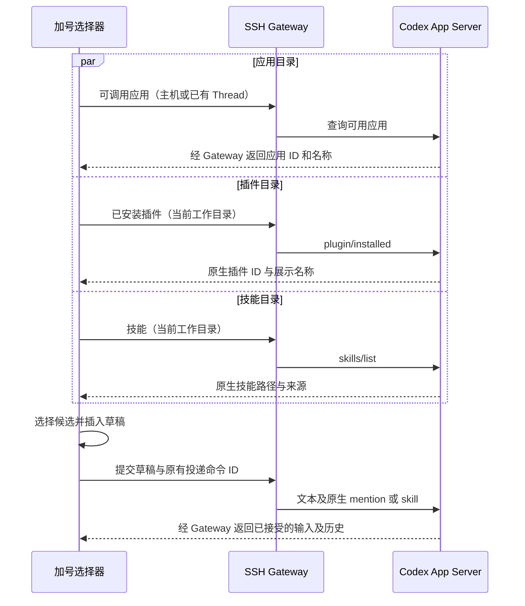

验收入口为 `node selfhost/tests/plugin-picker.mjs`、`node selfhost/tests/native-input.mjs` 和 `SELFHOST_COMPOSER_CODEX_BIN=/path/to/codex node selfhost/tests/native-extension-composer.mjs`。原生验收在临时 Codex 配置和本机模型服务中核对插件安装身份、两种同名技能的实际内容注入，以及 App、插件和 Skill 的冷启动历史。交互沿用 ZCode v4 的 [加号菜单](https://github.com/zai-org/ZCode/blob/a4b4445141eb7d3b3e99eada9292775383bfc44e/packages/ui/src/prompt-editor/ChatPromptActionMenu.tsx) 和输入内引用。原生转译参见 [App Server 文档](https://learn.chatgpt.com/docs/app-server)、[Codex 0.170 协议](https://github.com/openai/codex/blob/rust-v0.170.0/codex-rs/app-server-protocol/schema/typescript/v2/UserInput.ts) 和 [Codex 0.172 选择器](https://github.com/openai/codex/blob/rust-v0.172.0/codex-rs/tui/src/bottom_pane/chat_composer.rs)。

### SSH 主机上的插件与技能设置

在「来源管理」可直接添加 SSH 主机上的本地或 Git 市场。空来源列表也显示这一动作，复用 ZCode 现有来源确认与安装流程。

[SSH 技能设置与发现](./skills.md)描述技能作用域、原生内容预览、启停和发现的验收路径。

插件管理、插件商店和技能设置复用 ZCode 的原有页面。插件管理以当前 SSH 用户的 Codex 安装状态为准，商店按原生市场分组，安装与卸载使用完整的 `名称@市场`。远端账号市场与 SSH 主机上的本地或 Git 市场各自保留来源。插件详情显示原生目录和本机包中可读取的资料，已安装插件的技能用完整插件 ID 关联。打开详情不安装插件。

已安装插件使用 `plugin/installed`。商店并行检索主机市场和账号目录，分别显示加载状态、已返回的条目及读取错误。主机市场先用 `codex plugin marketplace list --json` 枚举，再按市场名称搜索插件。账号目录查询使用 `codex plugin list --json --available --marketplace openai-curated-remote`。账号目录首次加载或读取失败时，可以继续查看已安装插件和主机市场，也可打开 ChatGPT 插件目录；失败后提供重试入口。配置和安装状态以同一 SSH 主机的有效读取为准。目录暂时失败时保留当前主机上次返回的条目，过期的目录回包不能恢复已卸载状态或覆盖切换后的主机。OpenAI 标为开发中的市场协议不用于生产客户端。CLI 和 App Server 的结果以完整插件 ID 合并，区分账号目录和主机市场，包含安装策略、Codex 提供的展示字段与市场名。

插件用户级开关写入 `plugins."名称@市场".enabled` 的单个布尔值，由原生 App Server 重载并核对有效状态。账号插件支持本机停用与恢复，管理员停用的插件显示策略和禁用的开关。CLI 支持的主机市场和公共账号市场使用完整插件 ID 原生安装与卸载。个人及组织账号市场的卸载入口指向官方插件目录。目录报告不可安装的条目可查看详情，页面显示安装限制。已安装详情直接使用原生安装记录和可读取的本地包清单，即使对应市场目录尚未返回也可以打开。变更后先显示原生有效安装态，其余目录可继续加载。查看详情和刷新只读取数据。已安装列表提供「使用」，与详情的「立即试用」共用完整插件引用的草稿预填，用户发出消息后才使用能力；已停用或受策略限制的插件保留管理入口。与插件有关的技能和 MCP 在同一 App Server 上读取更新后的配置，新开的会话可用其已启用能力。

技能目录采用 `skills/list`，按当前目录与 `SKILL.md` 的绝对路径读取，技能开关调用 `skills/config/write`，保留作用域与来源。同名条目保留各自身份。

完成修改后重新读取远端状态。写入失败可从原页面重试，列表保留各接口能读取的事实。安装、卸载与新增市场不作为读取或刷新目录的副作用。页面切换 SSH 主机时不会套用上一次读取或操作的结果。

| 验收 | 场景 | 通过条件 |
| --- | --- | --- |
| SH-PLUGIN-MANAGEMENT | 设置、插件商店、两个来源的同名插件及同一插件的工作区切换 | 桌面与手机展示真实来源与安装态。详情、安装、停用、恢复和卸载针对完整插件 ID。操作后以远端目录刷新，另一来源的条目保持原状态。 |
| SH-PLUGIN-MARKETPLACE | 添加 SSH 主机本地市场或 Git 市场，官方目录首次读取延迟、失败后重试、返回安装限制；一个主机市场读取失败 | 已安装和主机市场各自出现，可在官方目录未返回时进入详情、安装或启停，并可打开 ChatGPT 插件目录。重试返回后补齐账号市场条目，失败的主机市场保留上次目录并显示错误。受限制的插件保留详情入口和限制说明。 |
| SH-PLUGIN-ACCOUNT | 账号市场中已安装的公共、个人插件和管理员停用的条目 | 可停用和恢复允许管理的插件；公共账号插件使用原生 CLI 卸载，个人账号插件可打开官方管理入口。已启用的行可直接预填新对话；已停用或受限制的行不提供「使用」。 |
| SH-PLUGIN-RUNTIME | 同一个隔离 App Server 在安装前已启动，本地市场有同名插件的技能 | 安装后读取相同服务器的有效安装与技能清单，停用和恢复仅影响选定插件，卸载后其技能退出清单。 |
| SH-SKILL-MANAGEMENT | 本地与插件技能同名、切换 User/Workspace、读取或写入失败 | 当前 SSH 目录的原生技能路径和来源可辨识。开关提交相应的 `SKILL.md` 路径，随后重新读取有效状态。技能目录失败时仍可独立查看插件。 |

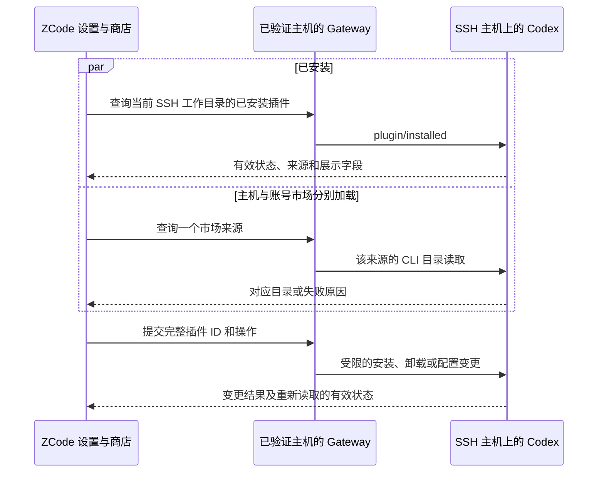

交互参见 ZCode v4 的 [插件商店](https://github.com/zai-org/ZCode/blob/a4b4445141eb7d3b3e99eada9292775383bfc44e/packages/ui/src/settings/PluginStorePage.tsx) 和[插件详情](https://github.com/zai-org/ZCode/blob/a4b4445141eb7d3b3e99eada9292775383bfc44e/packages/ui/src/settings/PluginStoreDetailView.tsx)。原生边界参见 [App Server 技能与插件协议](https://learn.chatgpt.com/docs/app-server)、[Codex CLI 插件实现](https://github.com/openai/codex/blob/rust-v0.172.0/codex-rs/cli/src/plugin_cmd.rs)和 [ChatGPT 与 Codex 插件目录](https://learn.chatgpt.com/docs/plugins)。

## 会话状态栏

已有会话有 Git 或原生 Thread 状态时，自托管 Web 在会话右上显示状态栏。按会话容器可用宽度裁决布局，1236px 视口打开项目侧栏时仍可同时看到对话和面板。宽屏默认展开并为消息和输入列留位，用户可收起。空间不足时从右上按钮展开，手机从同一位置打开底部抽屉。收展状态只属于当前会话视图。桌面原生布局保持原有状态入口。

Git 区读取会话工作树的现有 Git 服务，分支及「查看 Git」继续打开原有菜单或差异视图。Goal 由 Codex 的查询和后续事件更新。计划读取最新原生待办，完成项保留原有次序，已读取的正式计划可打开原有详情。子智能体以父 Thread 的原生活动和协作状态归约，同一子 Thread 只保留当前状态，活动和历史入口打开原有详情或目录。来源从已加载的原生时间线读取，标明用户提供的链接、网页搜索结果、原生访问和实际调用的外部工具，按来源种类和地址或工具身份去重。

设置及输入器的可配置子智能体目录使用各自的能力查询。当前 Codex App Server 的会话接口覆盖子智能体运行记录，配置目录返回该能力不可用及空结果。

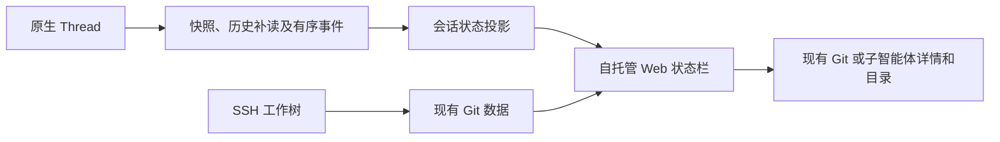

验收覆盖 1236px 和 1480px 展开、窄容器收展、390px 手机抽屉、实时子智能体等待与完成、Goal 变化、来源去重、会话切换及只读子智能体详情。

### 对话与状态栏滚动

对话时间线持有原生滚动视口，垂直滚动轨道贴齐会话容器的最右边缘。宽屏状态栏展开时，只对消息、输入栏和表格横向展开区域预留右侧空间。状态栏及窄屏弹层和主滚动轨道分开，长状态独立滚动。手机状态抽屉使用自身的滚动区。

在 1236px 和 1480px 带项目侧栏的布局、950px 窄屏及 390px 手机验证长对话和长状态。检查状态收展时主轨道的横向位置、消息及输入栏的对齐，以及两处滚动视口的读位。浏览历史时收展状态栏应保留脱离底部的阅读位置，跟随最新消息时保持吸底。

## 项目、历史和首轮

| 场景 | Web 入口 | SSH 主机上的权威数据 | Gateway 行为 |
| --- | --- | --- | --- |
| 按项目浏览 | 工作区项目侧栏 | `project/list` 的名称、根目录及位置，Thread 的 `projectId` | 投影原生项目与会话归属，本机旧归属经迁移 ID 映射；仍展示用户保存的 Web 目录 |
| 打开已有会话 | 侧栏或会话链接 | 原生 Thread、持久化时间线和写锁 | 首屏读最近一页，上翻按原生游标补历史；写锁冲突时以只读快照显示 |
| 首轮与自动命名 | Web 输入框 | `turn/start` 接受的首轮及 `thread/name/set` 持久化的标题 | 先反馈发送结果及可用的首句预览，再异步生成标题；保存前复查原生标题 |
| 回复延迟 | Web 输入框、SSH daemon | 目标目录的有效模型配置、Codex 通知、SSH daemon 的代理环境 | 标准轮次沿用所选模型或原生默认；浏览器收到重试提示；从 SSH daemon 的出站路径验证首字耗时 |

可读取原生项目的主机按保存顺序展示，即便项目暂时没有会话。已安装的 Mac Codex 版本会先迁移项目，原生 Thread 的归属可能仍为空。读取旧版桌面已保存的本地归属、无项目标记和迁移 ID 作为补充。原生非空归属优先。普通历史工作目录只在没有桌面项目目录的主机上用于发现项目；有桌面项目时，未登记目录的会话留在任务区。手工添加的 Web 目录继续可用。当前 SSH 工作区仅展示该账号本机项目。Web 在原生项目中创建的线程携带原生项目 ID，执行仍使用该线程的目录。

写锁由 Codex 管理。浏览器重新打开会话时可以再次尝试订阅；存在另一写者时，保留可读取的历史、禁用会话编辑和输入，并提示用户如何恢复。Goal 与旧历史分页均通过现有只读 RPC。切换会话、断线及更早页面的迟到回包按会话订阅和快照身份隔离。桌面宽度和手机宽度的自托管 Web 复用同一 replayable 链路。原生 ZCode Desktop continuous 仍由其 Host 附着。

任务目录由选定 SSH 主机上的 Codex 提供，账号置顶由 Gateway 结合原生行读取。已知 ID 的时间线、归档和置顶查询在原生 `thread/list` 中按 ID、目录和归档状态过滤。Codex 0.170.0 忽略 ID 筛选字段，Gateway 发现无关行时改为按所选 ID 读取元数据，以原生 rollout 所在的归档目录判断归档。目录刷新只读取最近 25 条的首个原生页，避免触发后台项目发现。请求精确总数的 `listTaskList` 依照原生游标读完整范围，再裁剪结果。相同主机、范围、关键词、排序和已知 ID 的并发读共享同一个在途结果。后续独立查询重新读取，改名、置顶或归档确认后的读取使用新查询世代。

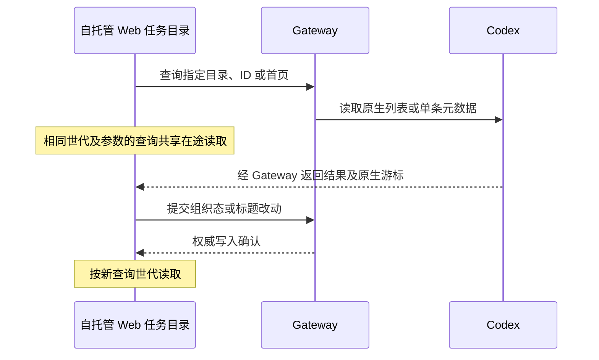

自动标题只处理 Web 创建会话的首个已接受文本轮次。短标题使用同一 SSH 主机的原生 Codex，通过临时只读会话和结构化输出生成。生成请求以首条用户文本的有界前缀为素材，关闭工具、MCP 和环境访问。模型无可用结果时使用首行的简短预览。用户已保存的标题优先，Gateway 对同一线程的手动改名与自动保存串行，自动保存前读取原生持久化名称。已有线程标题通过 Codex 的名称变更通知与目录刷新同步。

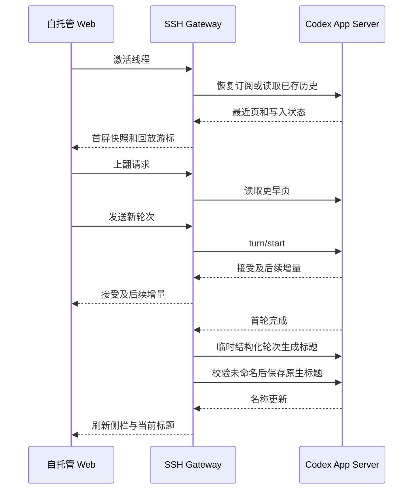

| 验收 | 设置与操作 | 证据 |
| --- | --- | --- |
| SH-PROJECTS | 同一 Mac 含原生项目、旧版归属、无项目历史；刷新侧栏并在项目中发送 | 项目顺序、归属、空项目、原生新线程项目 ID |
| SH-HISTORY | 桌面持有写锁时在 Web 打开；上翻、刷新、释放锁后重开 | 可读正文、分页顺序、只读提示、恢复发送 |
| SH-TITLE | 在 Web 新建并发送，另一浏览器刷新；手动命名一条等待自动命名的会话 | 原生标题保存、跨窗口更新、手动命名优先 |
| SH-LATENCY | Mac 独立 daemon 与桌面配置对照；用相同模型和推理强度发送短文本 | 记录接受、首个文本增量、完成及原生重试；同时确认生产侧 HTTPS 代理 |

## 输入图片和历史预览

自托管 Web 的新任务草稿以选中的 SSH 主机为上传目标。手机在任务列表点击「新建任务」后，使用同一主机的项目服务准备草稿，准备成功后进入输入框。选择、粘贴或拖入图片后，输入框立即使用已有的分片事务上传。浏览器以草稿作用域和上传 ID 管理进度与重试。Gateway 将图片写入该 SSH 用户的附件目录，返回文件引用后进度才完成。用户点击发送时创建原生 Thread，首轮携带已上传的引用，允许单独发送图片。原生 ZCode Desktop 的预上传由它的 CLI 会话持有。

打开已有 Thread 时，Codex 历史保有图片内容，Web 将图片投影到标准消息附件。`localImage.path` 通过当前主机的已认证文件服务分块读取。`image.url` 中的 Base64 AVIF、GIF、JPEG、PNG 和 WebP 沿用同一缩略图和大图预览，解码总大小沿用 20 MiB 附件限制。投影以 Turn、消息和图片在消息中的位置生成引用，读取时从当前 Thread 的原生消息分块解码。带 HTTP(S) 地址的历史图片在消息处显示文件名，在会话「来源」中提供外部打开入口。打开入口前浏览器不向外部图片地址发请求，Gateway 不代理该地址。缺失、无效或超限的图片内容不影响正文。只有 Codex 自动添加的文件清单与对应本地图片引用全部匹配时才收起清单。重连和向上加载历史共用原生消息投影。

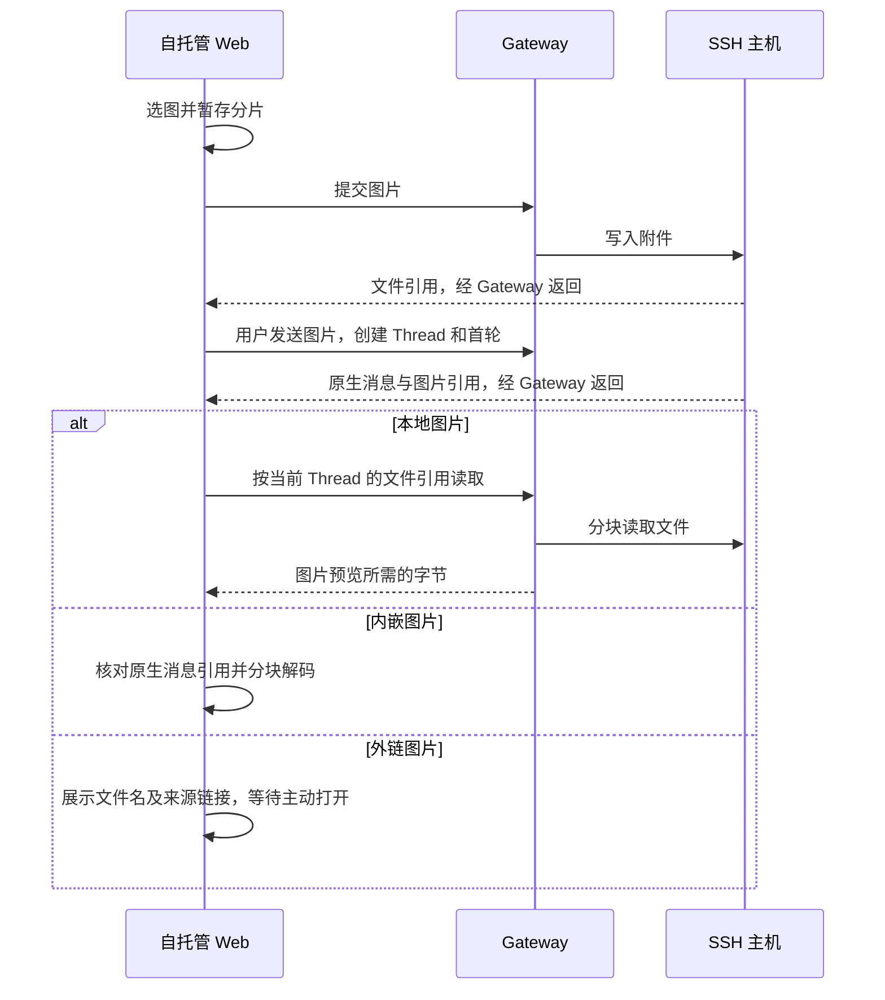

| 验收 | 设置与操作 | 证据 |
| --- | --- | --- |
| SH-DRAFT-IMAGE | 桌面打开新任务，手机从任务列表点击「新建任务」。选中 PNG，等待进度完成后直接发送图片 | 发送前已上传，提交期间仍显示进度，发送后创建一个 Thread 且首轮含对应图片 |
| SH-NATIVE-IMAGE | 桌面和手机打开包含本地、跨分块内嵌及外链图片的历史，预览大图后刷新，再主动打开来源链接 | 本地与内嵌图片可解码，正文可读且匹配的文件清单被收起。外链只在主动打开时请求，非图片数据不会渲染为缩略图 |

浏览器回归入口为 `node selfhost/tests/image-attachments.mjs`。

## 终端命令审批

桌面和手机宽度的自托管 Web 共用审批卡片。完整命令只显示在命令预览中。Codex 提供独立的审批理由时，在预览上方显示理由。没有理由、或理由与命令相同时，直接显示命令预览。

Web 按当前待答请求的 `availableDecisions` 提供已支持的决定。Codex 提供原生命令前缀决定时，显示「允许类似命令」和完整前缀，说明 Codex 会保存这条规则。较旧的 Codex 未提供决定列表时，可使用请求中的 `proposedExecpolicyAmendment`；没有有效前缀的命令继续使用基本选项。Codex 单独提供 `acceptForSession` 时显示「允许本会话」。命令前缀决定使用 Codex 提供的原始参数序列，匹配和规则保存由远端 Codex 管理。

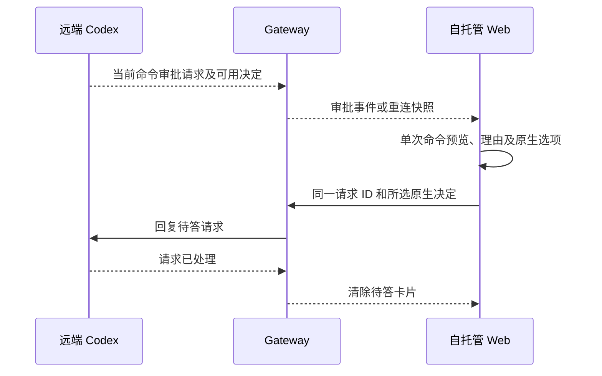

| 验收 | 设置与操作 | 证据 |
| --- | --- | --- |
| SH-COMMAND-APPROVAL | 桌面和手机宽度接收实时和恢复的命令审批，覆盖无理由、独立理由、重复理由、显式与兼容前缀、显式禁用前缀及会话放行 | 卡片中完整命令只出现一次；独立理由和完整前缀可读；点击所选决定后发出一次原生应答，卡片随请求处理而消失 |

浏览器回归入口为 `node selfhost/tests/command-approval.mjs`。

## 流式回复补同步

浏览器的 `SessionBridge` 持有当前工作区的 Web 订阅，远端 Codex 持有原生 Thread 与已接受的轮次。桌面宽度和手机宽度的 Web 都使用 replayable 投影。V4 会话、会话索引和工作区配置发生帧装配故障时，适配层在已有订阅上发布恢复快照，并依照公共 V4 协议返回 `{ ack: { subscriptionId, mode: "snapshot", logEpoch } }`。快照与确认可能先后抵达，接收方核对当前订阅后应用快照。订阅失效使用 `fault.subscription.notOwned`，由会话投影发起重新订阅。补同步只读取已有投影，不重发用户输入。原生 Desktop 的 continuous 订阅由独立的 Host 适配层管理。

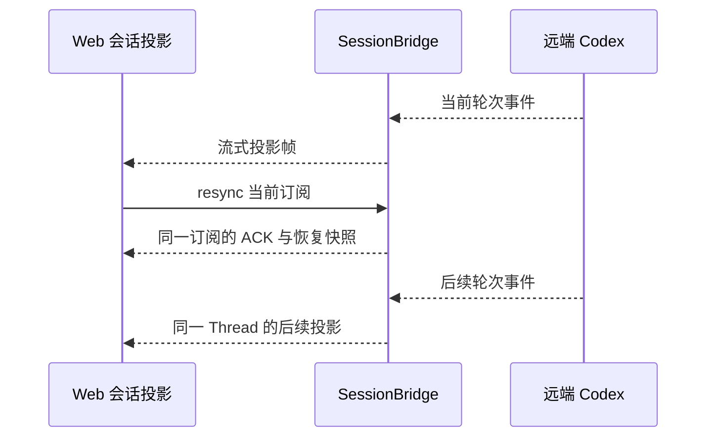

SH-RESYNC 验收在浏览器已有部分回复时制造帧装配故障，观察原订阅恢复、同轮后续内容和完成状态。另核对索引与配置的恢复确认，并验证已经关闭的订阅返回明确的归属错误。

## 连接异常提示

Codex App Server 持有模型请求及当前轮次状态。Web 收到当前轮次首条 `error` 通知且 `willRetry` 为真时，立即在回复区显示模型重连。Codex 提供次数时按原通知展示，次数缺失时显示纯文本进度。收到当前线程的 WebSocket 回退告警时显示正在通过 HTTPS 连接。同轮再次产生模型内容、下一轮开始或轮次结束时清除进度。最终失败从 `turn/completed` 或原生历史中读取，模型超时与其他模型连接失败使用输入框上方现有错误横幅，聊天记录与继续发送入口保留。

初次进入或重连时，Gateway 从现有有界事件缓冲读取与活动轮次对应的最近恢复事件，截止于原快照的回放游标。后续事件继续通过原订阅推进。浏览器与 Gateway 的连接由浏览器 `Gateway` 管理。WebSocket 意外关闭、握手失败或已认证的连接心跳超时时，保留工作区并显示自动重连，收到 `ready` 即清除。SSH 主机链路由 Gateway 的 Host Supervisor 管理，Web 使用认证后的主机生命周期事件提示当前主机的连接进度与失败，连接成功后清除。其他主机的事件不影响当前工作区。重连继续通过原订阅恢复线程，轮次由远端 Codex 继续负责。

需要 SSH 多因素认证的主机在 Gateway 重启后保持待连接。订阅主机生命周期时，Host Supervisor 向订阅者返回同一登录账号下仍需主动连接的主机状态。用户在主机列表或已打开的工作区点击「连接主机」后才发送 `host.mfa.connect`。Gateway 原有 MFA 管理器持有 SSH 挑战与超时，认证完成前可用 `host.mfa.request` 重放当前挑战。Web 展示选定主机的实际提示文本和输入可见性，以原 `host.mfa.submit` 提交单项回答或用 `host.mfa.cancel` 取消。处于多项挑战时可取消并从原生 SSH 客户端处理。验证码只存在当次表单和当前认证 WebSocket 内，断线、取消、切换账号或主机时清除输入，连接成功后清除该主机提示。其余主机和已有会话的重连路径继续按原订阅运行。

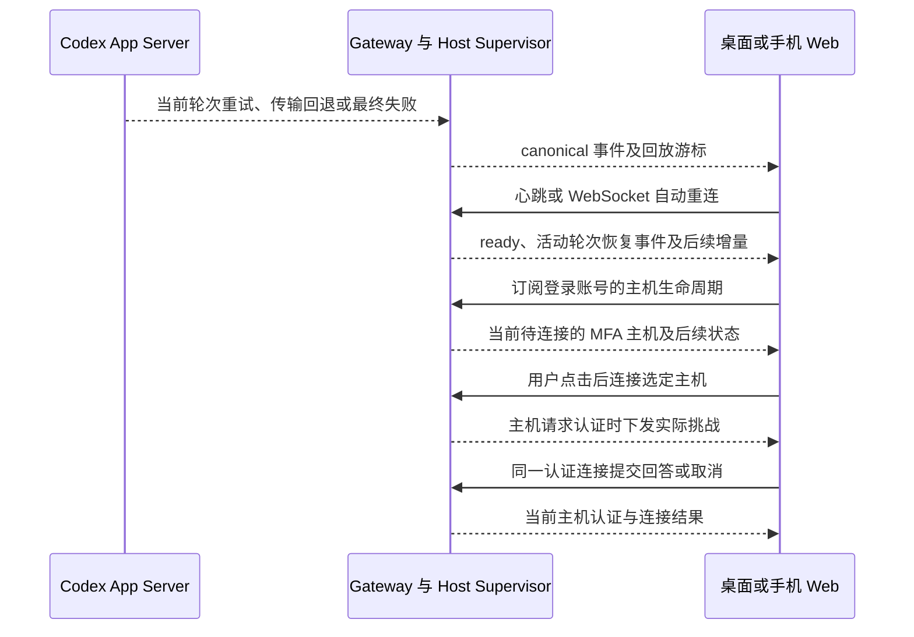

| 验收 | 设置与操作 | 证据 |
| --- | --- | --- |
| SH-NETWORK-MODEL | 当前轮次模拟 `2/5`、无次数重试、HTTPS 回退、输出恢复、最终超时及页面重开 | 重试即时可见、进度随同轮清除、重连恢复有效进度、失败原因可见且聊天记录保留 |
| SH-NETWORK-LINK | 断开浏览器 WebSocket、模拟心跳丢失和 SSH 主机失败，再恢复连接 | 桌面和手机提示对应链路、恢复清除、其他主机事件隔离、重连未重发输入 |
| SH-NETWORK-MFA | Gateway 重启后订阅、显式 SSH 连接、异主机挑战、取消后重试和提交、切换两个主机 ID 相同的账号 | 连接入口持续可见。切换账号时等该账号的主机目录返回后再显示挑战与名称。挑战可填写、取消或重试，确认后清除。输入保持在当次验证里。 |

SSH 多因素认证沿用 [Gateway 原认证命令](https://github.com/yunhaoli24/codex-gateway/blob/76200537c19f0c4075153c1458667a07e804db6c/server/utils/gateway/realtime/handlers/host-mfa.ts) 与[主机认证界面](https://github.com/yunhaoli24/codex-gateway/blob/76200537c19f0c4075153c1458667a07e804db6c/app/components/sidebar/host-tree/HostMfaDialog.vue)。

## 2026-11-24 发布验收

### SSH 会话与逐轮变更

发布镜像为 `zcode-selfhost:20261124-native-ssh`，应用提交为 `3a53d37b`。真实服务的桌面和手机宽度均通过登录、SSH 项目、历史、文件与会话操作验收。1236px 的右上面板可收展，390px 的抽屉可查看 Git。在专用 Mac 工作区通过真实文件审批产生单文件补丁，确认预览后首次撤销成功。刷新后原对话和文件卡仍在，既有文件和 Git 暂存区逐字节核对通过。手机纯图片首发在独立浏览器重开后，缩略图和原图均可解码，原图的 SHA-256 与上传样本相同。

同一 Mac、同一提示、`gpt-6.2-sol` 和 `low` 的计时如下。直连起点为写入原生 `turn/start`，网页起点为浏览器发送对应请求。隔离服务和线上均通过真实 SSH 使用该 Mac。各组均未发生模型重试。

| 路径 | 样本 | 接纳 | 首个文字增量 | 浏览器首字可见 | 完成 |
| --- | ---: | ---: | ---: | ---: | ---: |
| 原生 App Server | 3 次中位数 | 2 ms | 7.766 s | — | 8.358 s |
| 隔离 Web 服务 | 3 次中位数 | 94 ms | 8.674 s | 8.736 s | 9.162 s |
| 正式 Web 服务 | 1 次 | 72 ms | 8.647 s | 8.732 s | 9.290 s |

0.170.0 和 0.172.0 的独立官方二进制各通过 9 组使用合成模型响应的协议验收，包括新旧历史、引导、队列、分支、压缩、结构化输入与重启恢复。浏览器隔离回归覆盖双端审批竞争、断网与 SSH 恢复。独立 Compose 实例完成了健康检查失败、重试、真正回退至原镜像、重新登录及历史读取。仓库类型检查与架构检查通过，Lint 为 537 条告警、0 错误。

### 扩展管理、滚动与复制

发布镜像 `zcode-selfhost:20261124-codex-extensions` 对应应用提交 `c7c3f8a1`。在正式服务从 1480px 和 390px 的独立浏览器登录，通过 SSH 打开三个管理入口。实测主机返回 17 个已安装应用，其中 14 个返回了工具清单，另读取到 48 项技能。安装、卸载、同名插件来源区分、应用与技能开关分别在隔离配置和浏览器夹具中验证，覆盖官方 Codex 0.170.0 与 0.172.0。

使用正式服务的前端资源和固定对话样例，1236px 和 1480px 均能在窗口最右侧拖动主对话滚动条，950px 弹层和 390px 抽屉通过回归。局域网 HTTP 的桌面点击和手机触摸均成功复制带中文与表情的表格，实际粘贴保留表头、分隔行和全部数据行。安全上下文与拒绝写入在浏览器隔离回归中验证。手机场景使用 Chromium 触摸模拟。

本版类型检查和架构检查通过。Lint 为 530 条告警、0 个错误，受影响的工程测试 281 项通过、1 项跳过。

## 2026-11-25 扩展中心发布验收

正式服务已更新至 `zcode-selfhost:20261125-workspace-extensions-final`。发布前备份 SQLite 和服务配置，记录上一版健康镜像的精确 ID。验收使用独立网页登录账号和专用 SSH 项目。桌面与手机宽度从侧栏进入同一个扩展中心，加号内的管理入口可返回原聊天草稿。

| 正式服务场景 | 实际结果 |
| --- | --- |
| 1480px，经 SSH 使用 Mac 上的 Codex 0.172.0 选择 Google Drive | 原生目录和详情页各有 47 个工具。完成一次主机连接检查后，从点击「应用」到「使用 Google Drive」可见的一次采样是 8.124 秒。选择应用并发送后，真实模型返回了目录中的 `mcp__codex_apps__google_drive_search`。验证范围为工具发现。 |
| 390px，经 SSH 使用 Linux 上的 Codex 0.171.0 管理项目技能 | 从作用域菜单直达当前项目，停用和恢复测试技能，打开远端 `SKILL.md`，点击「使用」后再发送。受控模型在收到指定技能正文后返回验收标记。手机触摸复制这条真实回复，可粘贴到未发送的输入框。 |
| 390px，在同一隔离主机管理插件 | 通过来源对话框添加私有市场，安装插件、停用、恢复，从已安装列表带入草稿并发送。页面重开后可见原回复，随后在界面卸载插件并移除市场。 |

三条正式会话都从独立启动的 Codex App Server 用 `thread/read` 和 `thread/turns/list` 读回。应用和插件保留原生 `mention`，技能保留原生 `skill` 和所选路径。官方 0.170.0、0.172.0 还分别通过了 1480px 与 390px 的作用域验收，覆盖同名条目、跨主机过滤和项目 B 的草稿归属。手机宽度使用 Chromium 触摸模拟。

隔离服务重启后实测需要主动连接的 SSH 主机，网页显示连接入口，点击后同一请求从 HTTP 502 恢复为 200。回归还通过了右侧面板、逐轮文件卡、撤销冲突，以及两种宽度下普通 HTTP、安全上下文和剪贴板拒绝的六组实际粘贴。`pnpm typecheck` 和架构检查通过，Lint 为 530 条告警、0 个错误，本次 React Hooks 专项新增告警为 0。受影响工程测试 281 项通过、1 项跳过，发布与上游管理测试 7 项通过。

## 发布后的空间回收

在构建机和服务端确认新版验收通过后，清理该次发布的临时构建目录、传输归档及本项目已替换的镜像。Compose 更新等待 `codex-web` 健康才进入镜像清理。保留当前镜像、任意容器引用的镜像、晚于当前版本构建的候选镜像及更新前的一版回滚镜像。清理的镜像限于 `zcode-selfhost` 发布仓库。清理前核对 Docker daemon 与已验证的容器 ID 和镜像 ID，若更新失败则保留发布前镜像。

SH-RELEASE 验收覆盖健康更新后清理废弃标签、已有容器和回滚引用、其他项目镜像和失败更新保留现场。持久数据卷、数据库、配置、密钥及备份由服务端部署独立管理。

## 会话文本复制

Markdown 表格、代码块、消息和链接复制写入当前设备剪贴板。表格保留现有 Markdown 文本格式，包括表头、分隔行、各数据行与单元格转义。代码块和消息保留已有文本内容。Markdown 链接菜单与分享成功结果复制各自的完整 URL。空内容保留当前剪贴板。

`IPlatformService.writeClipboardText` 管理文本写入。安全上下文使用浏览器 Clipboard API；局域网 HTTP 缺少该 API 时在原点击或键盘激活中同步执行浏览器的文本复制命令，保留焦点和选区。只读分享的共享渲染器使用同一个浏览器实现。浏览器拒绝写入时显示本地化失败提示。成功反馈只在浏览器确认写入后展示。

SH-CLIPBOARD 浏览器验收使用 `node selfhost/tests/clipboard.mjs`。1480px 和 390px 在非安全 HTTP 与安全上下文均点选表格、代码块和消息复制并实际粘贴，核对 Unicode、换行和成功反馈。桌面右键和手机长按后，用链接菜单复制完整 URL，等菜单结束退场后再将焦点移入验收用的粘贴输入框。拒绝写入时显示失败，粘贴仍得到原有内容。私有分享页验证复用的表格和代码块复制，以及复制后的焦点与选区。分享成功结果用受控的已发布状态验证复制链接。

验收使用 Chromium Headless Shell 的内存剪贴板。预览服务仅监听回环地址，浏览器显式选择直连，并将普通 HTTP 场景的测试域名解析到该地址。安全与拒绝场景在 URL 中使用回环地址。文档导航最多等待 30 秒，进入工作区后按对话内容和操作反馈判断就绪。JavaScript 和样式由同一预览服务直接返回，权限拒绝由文档的 `Permissions-Policy` 响应头触发。可运行 `pnpm exec playwright-core install chromium --only-shell` 安装，也可用 `SELFHOST_CLIPBOARD_HEADLESS_SHELL` 指定已安装的 Headless Shell。

参考 [OpenAI App Server 协议](https://learn.chatgpt.com/docs/app-server)、[Codex CLI 项目协议](https://github.com/openai/codex/blob/rust-v0.172.0/codex-rs/app-server-protocol/src/protocol/common.rs)、[Codex CLI 的自动命名](https://github.com/openai/codex/blob/rust-v0.172.0/codex-rs/tui/src/app/thread_title.rs)。
