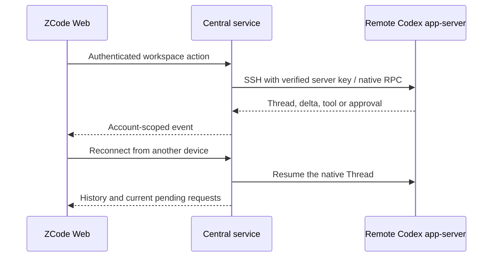
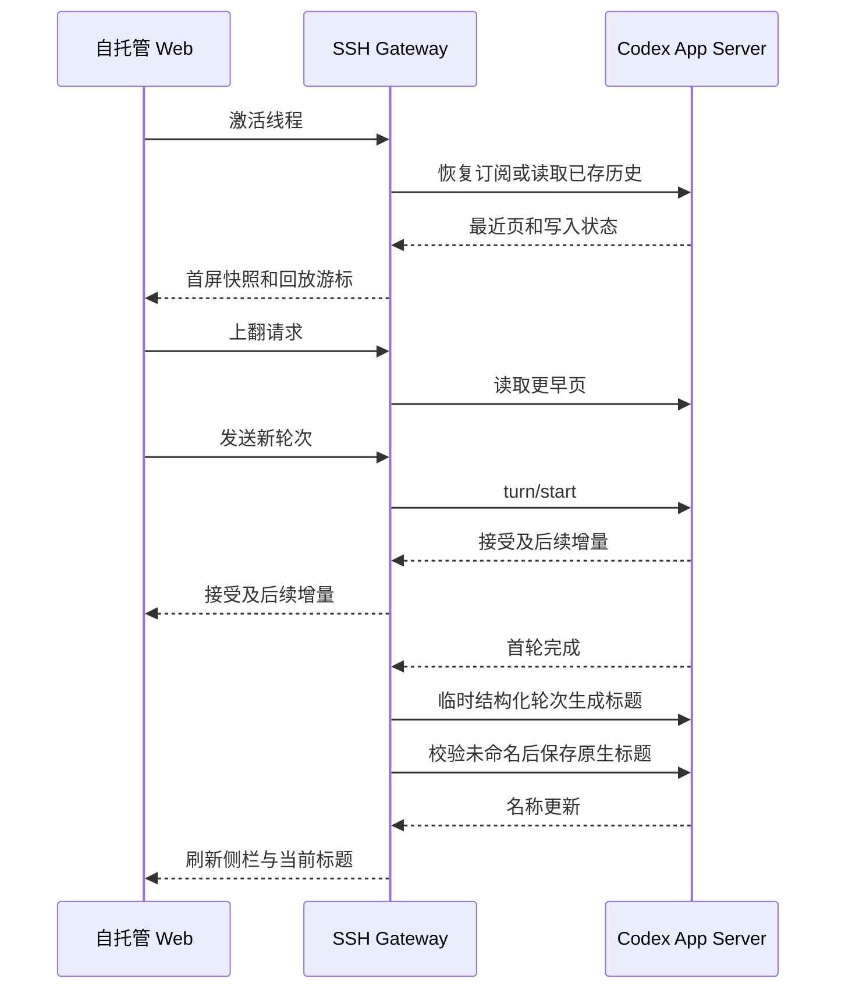
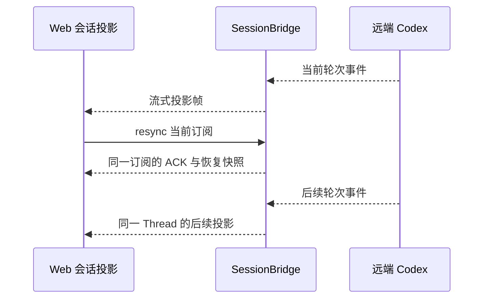
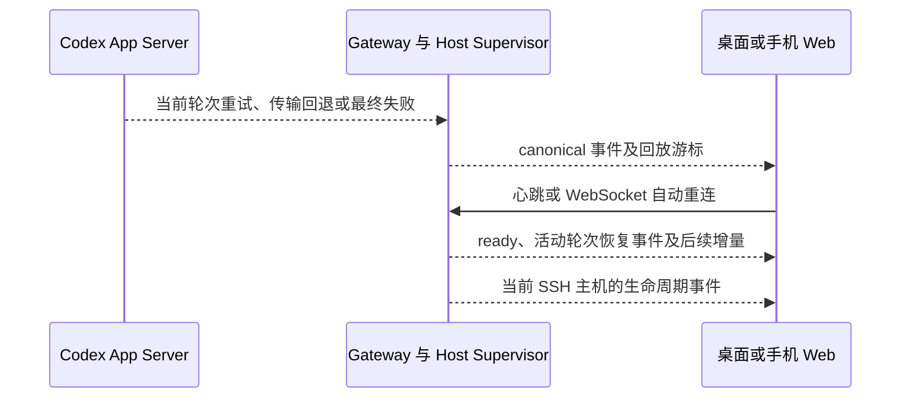

# Self-hosted SSH Codex

ZCode owns the Web interface for desktop and phone. The authenticated central service owns host definitions, trusted SSH host keys, project navigation and browser event fan-out. The selected SSH account owns its Codex process, files, Git work tree, PTYs and persistent native Threads.

Acceptance includes a real model list and reasoning control, native prompt editor with draft retention, original layout at desktop and phone widths, independent browser login, real model/tool/approval events, history after reconnect, remote Git/files/PTY, host key mismatch, and persistent server configuration. Commercial service endpoints are excluded from the self-host build. The external deployment port is 33723.

## 项目、历史和首轮

| 场景 | Web 入口 | SSH 主机上的权威数据 | Gateway 行为 |
| --- | --- | --- | --- |
| 按项目浏览 | 工作区项目侧栏 | `project/list` 的名称、根目录及位置，Thread 的 `projectId` | 投影原生项目与会话归属，本机旧归属经迁移 ID 映射；仍展示用户保存的 Web 目录 |
| 打开已有会话 | 侧栏或会话链接 | 原生 Thread、持久化时间线和写锁 | 首屏读最近一页，上翻按原生游标补历史；写锁冲突时以只读快照显示 |
| 首轮与自动命名 | Web 输入框 | `turn/start` 接受的首轮及 `thread/name/set` 持久化的标题 | 先反馈发送结果及可用的首句预览，再异步生成标题；保存前复查原生标题 |
| 回复延迟 | Web 输入框、SSH daemon | 目标目录的有效模型配置、Codex 通知、SSH daemon 的代理环境 | 标准轮次沿用所选模型或原生默认；浏览器收到重试提示；从 SSH daemon 的出站路径验证首字耗时 |

可读取原生项目的主机按保存顺序展示，即便项目暂时没有会话。已安装的 Mac Codex 版本会先迁移项目，原生 Thread 的归属可能仍为空。读取旧版桌面已保存的本地归属、无项目标记和迁移 ID 作为补充。原生非空归属优先。普通历史工作目录只在没有桌面项目目录的主机上用于发现项目；有桌面项目时，未登记目录的会话留在任务区。手工添加的 Web 目录继续可用。当前 SSH 工作区仅展示该账号本机项目。Web 在原生项目中创建的线程携带原生项目 ID，执行仍使用该线程的目录。

写锁由 Codex 管理。浏览器重新打开会话时可以再次尝试订阅；存在另一写者时，保留可读取的历史、禁用会话编辑和输入，并提示用户如何恢复。Goal 与旧历史分页均通过现有只读 RPC。切换会话、断线及更早页面的迟到回包按会话订阅和快照身份隔离。桌面宽度和手机宽度的自托管 Web 复用同一 replayable 链路。原生 ZCode Desktop continuous 仍由其 Host 附着。

自动标题只处理 Web 创建会话的首个已接受文本轮次。短标题使用同一 SSH 主机的原生 Codex，通过临时只读会话和结构化输出生成。生成请求以首条用户文本的有界前缀为素材，关闭工具、MCP 和环境访问。模型无可用结果时使用首行的简短预览。用户已保存的标题优先，Gateway 对同一线程的手动改名与自动保存串行，自动保存前读取原生持久化名称。已有线程标题通过 Codex 的名称变更通知与目录刷新同步。

| 验收 | 设置与操作 | 证据 |
| --- | --- | --- |
| SH-PROJECTS | 同一 Mac 含原生项目、旧版归属、无项目历史；刷新侧栏并在项目中发送 | 项目顺序、归属、空项目、原生新线程项目 ID |
| SH-HISTORY | 桌面持有写锁时在 Web 打开；上翻、刷新、释放锁后重开 | 可读正文、分页顺序、只读提示、恢复发送 |
| SH-TITLE | 在 Web 新建并发送，另一浏览器刷新；手动命名一条等待自动命名的会话 | 原生标题保存、跨窗口更新、手动命名优先 |
| SH-LATENCY | Mac 独立 daemon 与桌面配置对照；用相同模型和推理强度发送短文本 | 记录接受、首个文本增量、完成及原生重试；同时确认生产侧 HTTPS 代理 |

## 流式回复补同步

浏览器的 `SessionBridge` 持有当前工作区的 Web 订阅，远端 Codex 持有原生 Thread 与已接受的轮次。桌面宽度和手机宽度的 Web 都使用 replayable 投影。V4 会话、会话索引和工作区配置发生帧装配故障时，适配层在已有订阅上发布恢复快照，并依照公共 V4 协议返回 `{ ack: { subscriptionId, mode: "snapshot", logEpoch } }`。快照与确认可能先后抵达，接收方核对当前订阅后应用快照。订阅失效使用 `fault.subscription.notOwned`，由会话投影发起重新订阅。补同步只读取已有投影，不重发用户输入。原生 Desktop 的 continuous 订阅由独立的 Host 适配层管理。

SH-RESYNC 验收在浏览器已有部分回复时制造帧装配故障，观察原订阅恢复、同轮后续内容和完成状态。另核对索引与配置的恢复确认，并验证已经关闭的订阅返回明确的归属错误。

## 连接异常提示

Codex App Server 持有模型请求及当前轮次状态。Web 收到当前轮次首条 `error` 通知且 `willRetry` 为真时，立即在回复区显示模型重连。Codex 提供次数时按原通知展示，次数缺失时显示纯文本进度。收到当前线程的 WebSocket 回退告警时显示正在通过 HTTPS 连接。同轮再次产生模型内容、下一轮开始或轮次结束时清除进度。最终失败从 `turn/completed` 或原生历史中读取，模型超时与其他模型连接失败使用输入框上方现有错误横幅，聊天记录与继续发送入口保留。

初次进入或重连时，Gateway 从现有有界事件缓冲读取与活动轮次对应的最近恢复事件，截止于原快照的回放游标。后续事件继续通过原订阅推进。浏览器与 Gateway 的连接由浏览器 `Gateway` 管理。WebSocket 意外关闭、握手失败或已认证的连接心跳超时时，保留工作区并显示自动重连，收到 `ready` 即清除。SSH 主机链路由 Gateway 的 Host Supervisor 管理，Web 使用认证后的主机生命周期事件提示当前主机的连接进度与失败，连接成功后清除。其他主机的事件不影响当前工作区。重连继续通过原订阅恢复线程，轮次由远端 Codex 继续负责。

| 验收 | 设置与操作 | 证据 |
| --- | --- | --- |
| SH-NETWORK-MODEL | 当前轮次模拟 `2/5`、无次数重试、HTTPS 回退、输出恢复、最终超时及页面重开 | 重试即时可见、进度随同轮清除、重连恢复有效进度、失败原因可见且聊天记录保留 |
| SH-NETWORK-LINK | 断开浏览器 WebSocket、模拟心跳丢失和 SSH 主机失败，再恢复连接 | 桌面和手机提示对应链路、恢复清除、其他主机事件隔离、重连未重发输入 |

## 发布后的空间回收

在构建机和服务端确认新版验收通过后，清理该次发布的临时构建目录、传输归档及本项目已替换的镜像。Compose 更新等待 `codex-web` 健康才进入镜像清理。保留当前镜像、任意容器引用的镜像、晚于当前版本构建的候选镜像及更新前的一版回滚镜像。清理的镜像限于 `zcode-selfhost` 发布仓库。清理前核对 Docker daemon 与已验证的容器 ID 和镜像 ID，若更新失败则保留发布前镜像。

SH-RELEASE 验收覆盖健康更新后清理废弃标签、已有容器和回滚引用、其他项目镜像和失败更新保留现场。持久数据卷、数据库、配置、密钥及备份由服务端部署独立管理。

参考 [OpenAI App Server 协议](https://learn.chatgpt.com/docs/app-server)、[Codex CLI 项目协议](https://github.com/openai/codex/blob/rust-v0.172.0/codex-rs/app-server-protocol/src/protocol/common.rs)、[Codex CLI 的自动命名](https://github.com/openai/codex/blob/rust-v0.172.0/codex-rs/tui/src/app/thread_title.rs)。
