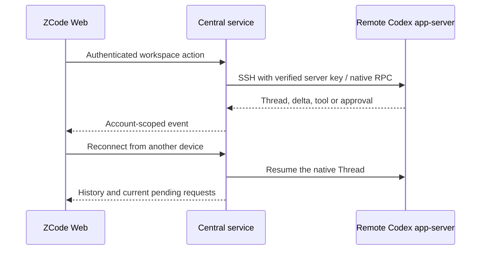

# Self-hosted SSH Codex

ZCode owns the Web interface for desktop and phone. The authenticated central service owns host definitions, trusted SSH host keys, project navigation and browser event fan-out. The selected SSH account owns its Codex process, files, Git work tree, PTYs and persistent native Threads.

Acceptance includes a real model list and reasoning control, native prompt editor with draft retention, original layout at desktop and phone widths, independent browser login, real model/tool/approval events, history after reconnect, remote Git/files/PTY, host key mismatch, and persistent server configuration. Commercial service endpoints are excluded from the self-host build. The external deployment port is 33723.

## 发布后的空间回收

在构建机和服务端确认新版验收通过后，清理该次发布的临时构建目录、传输归档及本项目已替换的镜像。Compose 更新等待 `codex-web` 健康才进入镜像清理。保留当前镜像、任意容器引用的镜像、晚于当前版本构建的候选镜像及更新前的一版回滚镜像。清理的镜像限于 `zcode-selfhost` 发布仓库。清理前核对 Docker daemon 与已验证的容器 ID 和镜像 ID，若更新失败则保留发布前镜像。

SH-RELEASE 验收覆盖健康更新后清理废弃标签、已有容器和回滚引用、其他项目镜像和失败更新保留现场。持久数据卷、数据库、配置、密钥及备份由服务端部署独立管理。
