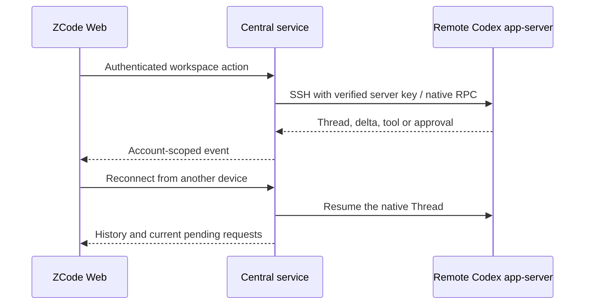
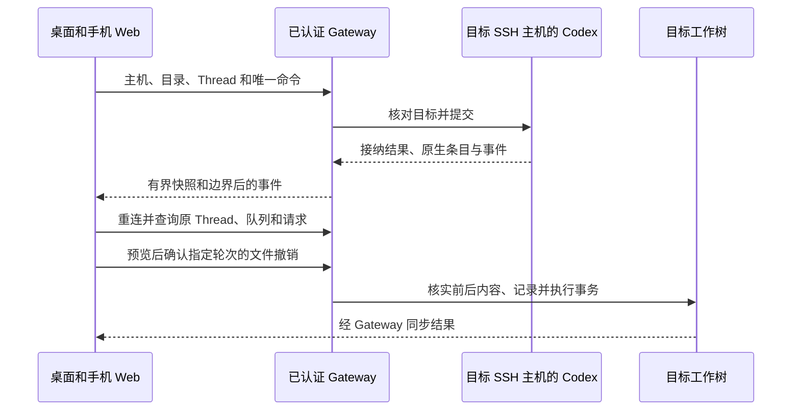
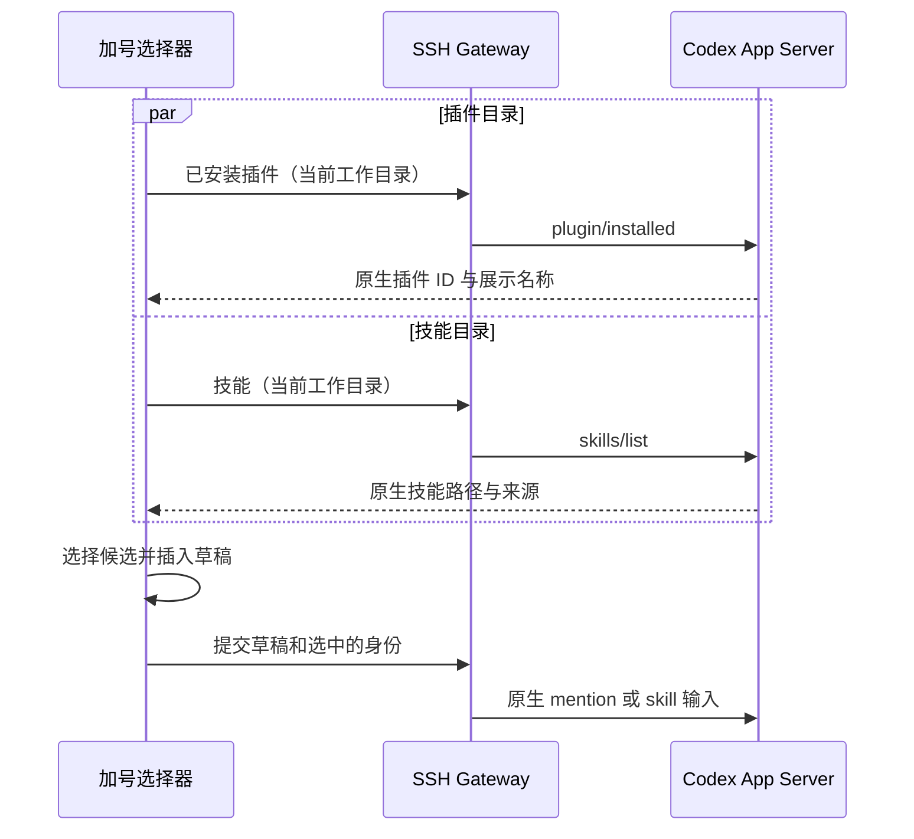
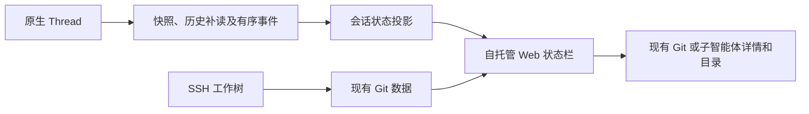
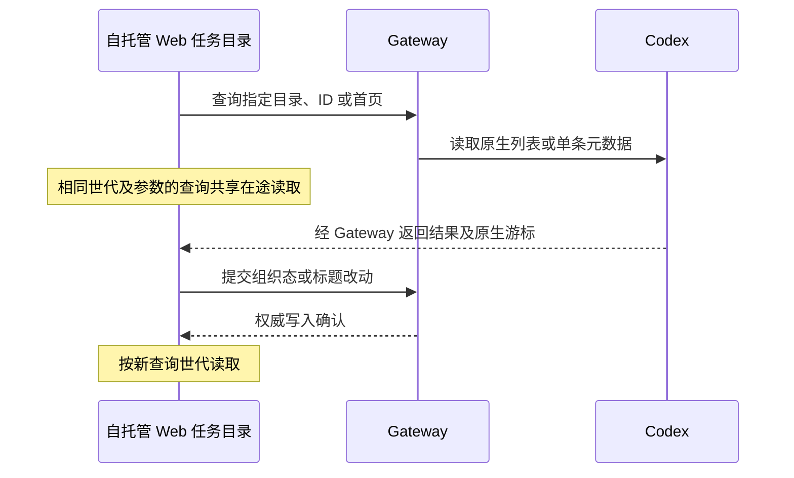
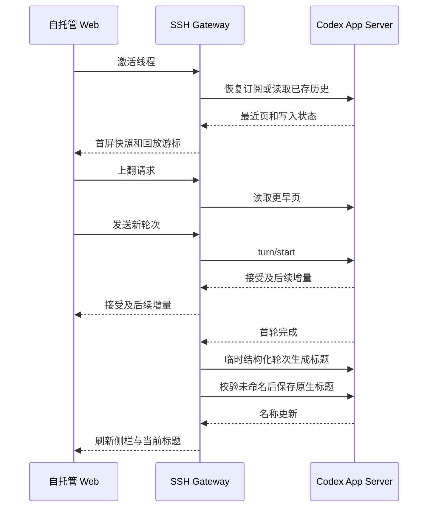
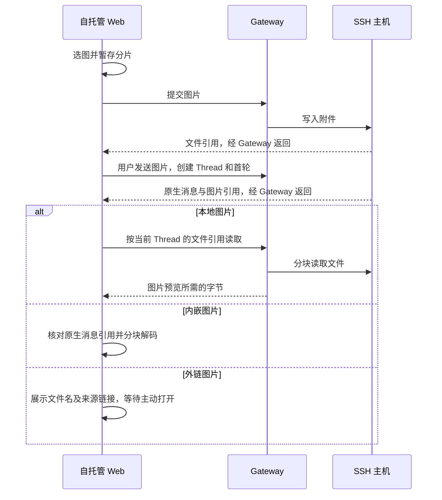
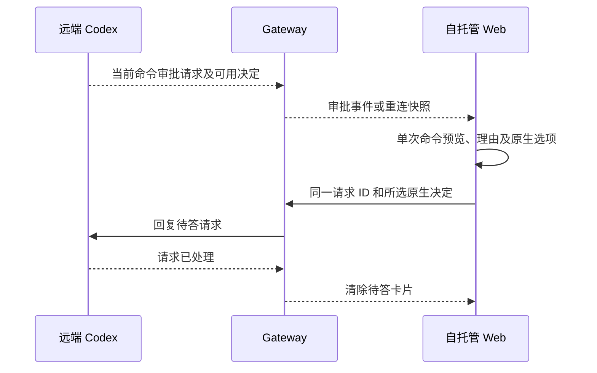
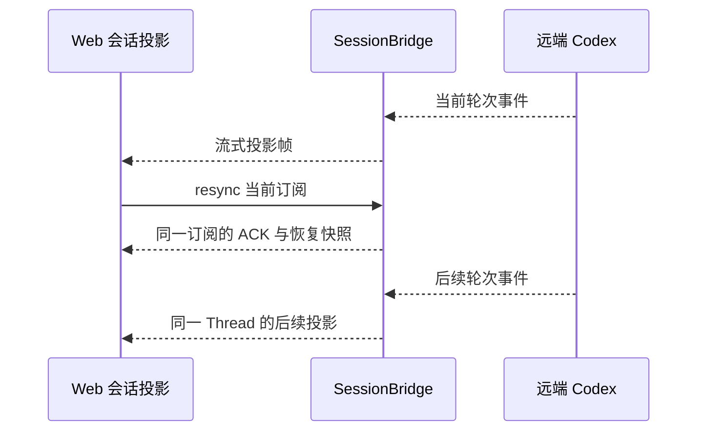
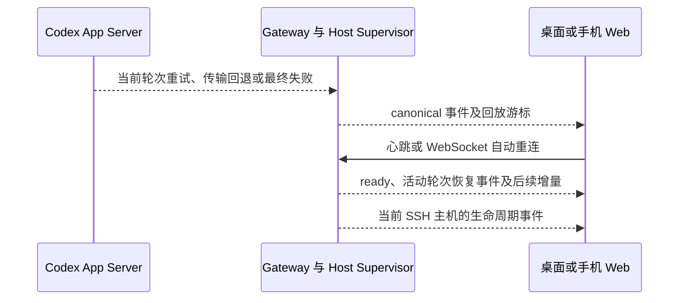

# Self-hosted SSH Codex

ZCode owns the Web interface for desktop and phone. The authenticated central service owns host definitions, trusted SSH host keys, project navigation and browser event fan-out. The selected SSH account owns its Codex process, files, Git work tree, PTYs and persistent native Threads.

Acceptance includes a real model list and reasoning control, native prompt editor with draft retention, original layout at desktop and phone widths, independent browser login, real model/tool/approval events, history after reconnect, remote Git/files/PTY, host key mismatch, and persistent server configuration. Commercial service endpoints are excluded from the self-host build. The external deployment port is 33723.

## 原生协议与工作区验收

每个 Web 工作区的服务归已验证的 SSH 主机和目录所有。浏览器只投影原生事实，Gateway 按账号、主机、Thread 和连接世代路由。桌面和手机 Web 使用同一可回放订阅，原生 Electron 的连续投递仍走窗口 Host。

| 场景 | 已复现的触发条件 | 所有者、接口和通过条件 |
| --- | --- | --- |
| SH-TARGET | 在相同路径的两台主机间切换，或在 A 项目新建指向 B 的自动化 | 工作区只挂载匹配当前主机与目录的服务。调度持久化所选项目，在领取和派发时校验主机身份。替换连接身份后原任务暂停，配置与历史可查。 |
| SH-HISTORY-FORMAT | 打开 legacy、分页历史、其他写者或提供商不匹配的 Thread | Codex 持有读写资格。legacy 按轮次游标读取，分页历史沿用时间线。写者冲突或提供商不兼容时历史可读。新会话尚未落盘时复用已接纳的原生订阅。 |
| SH-REPLAY | 激活与订阅之间完成一轮、仅 SSH 断开、快照读取途中出现增量、上翻跨页长轮 | Gateway 给出与快照内容一致的回放边界，Web 按订阅世代及有序事件 ID 应用增量。恢复后文字完整、终态稳定、用户行位置稳定。失败保留已读内容并可重试。 |
| SH-SEND | 创建成功或首轮接纳后丢回执、忙时带图引导、顺序完成 65 个上传 | 先绑定真实 Thread ID，再发送首轮。已发但未确认时按原生用户行的 clientId 查账，缺乏正向证据保留待确认输入。输入引用一致进入 start 或 steer。上传完成释放活跃配额，同一上传 ID 的完成回执可重读。 |
| SH-INTERACTIONS | 同命令多个审批、两端同时决定、同题面不同题目 ID、无轮次的 MCP 表单 | 原生请求 ID 独立清场。显示真实命令、主机、范围和期限。问题按 ID 回答，支持跳过、部分答案和掩码输入。拒绝或失败保留真实结果，无轮次请求不产生可控制的活动轮次。 |
| SH-LIST-SHARE | 同时查询两个目录、按创建时间排序、归档后恢复、在 600 条 Thread 中查询已知 ID 与目录预览、分享跨页选择 | 原生项目及归档状态和账号置顶各有单一所有者。已知 ID 定点或批量读取，目录预览仅读首个原生页，同范围并发查询复用。需要精确总数时完成分页。分享预检与发布使用同一组所选原生轮次，缺少一轮即报告。 |
| SH-CATALOG | 旧 Thread 使用另一提供商、模型目录失败、加号中选择同名 Skill 或插件、MCP 发现失败或要求重新认证 | 目录按主机、目录及 Thread 提供商选择。目录故障独立于历史和文件。选中的原生 skill/mention 随最终输入发送。MCP 设置及工作流文件管理复用已注册服务。两条 MCP 状态查询共用 Codex 运行状态、认证及工具发现结果。旧响应仍能凭已初始化服务或工具返回连接状态。 |
| SH-REMOTE-IO | 已展开目录的 SSH 通道中断、网页断线期间 PTY 退出 | 以 SSH 世代重新建立所需文件监听并补读。WebSocket 恢复时核对该账号已知 PTY，保留仍活跃的会话并报告已退出的终端。 |
| SH-NATIVE-CONTROLS | 运行时排队、刷新后取消、从选中已完成轮创建分支、触发压缩 | 原生队列持有接受顺序，Web 回读并按队列 ID 取消。从已完成轮指定边界创建子 Thread。上下文用量及压缩进度来自原生事件；主机能力决定入口。 |
| SH-STATUS | 官网示例宽度下有 Git、Goal、计划、子智能体和来源，切换会话及屏幕宽度 | 自托管桌面在空间足够时默认展开可折叠的右上面板，窄屏用右上按钮，手机用抽屉。各节使用当前工作树或 Thread 的真实数据。 |
| SH-TURN-FILES | 两轮修改不同文件、同一路径被再次编辑、预览后外部修改或执行中断 | 每轮展示原生 Turn 的文件、净增删和补丁。SSH 工作进程按确证的前后内容及有效工作区验证整批撤销，冲突标出文件，保护后续修改、暂存区与历史。可恢复的事务按操作 ID 对账。 |
| SH-REWIND-MAC | SSH 进程把普通文件移入私有事务目录后，macOS 自动更新同一 inode 的系统来源属性 | 移动前核对全部元数据；仅对事务自己移动的同一文件接受系统来源属性更新，核对原件身份、内容、权限、用户组和其他扩展属性。失败恢复文件并显示原因。 |
| SH-ALIAS-FIRST | Mac 上从目录别名首发，原生接纳时项目列表尚未收录，首轮需要审批 | 原生创建和发送回执确定目标 Thread 后立即从草稿进入该会话。目录和分组读模型随后刷新。文件凭据、自动化目标按 SSH 主机解析的真实目录核对。 |
| SH-RELEASE-RETRY | 新容器替换了健康 A 后首次等待失败，再次更新到 B | 发布目录在替换前记录并保留 A 的镜像 ID。重试后 B 活跃、A 可回退；功能验收后才清理本项目未引用的旧镜像和临时归档。 |

## 输入框插件和技能

自托管 Web 的加号分别列出当前 SSH 工作目录可引用的已启用插件和技能。Codex App Server 的 `plugin/installed` 和 `skills/list` 分别提供候选。插件选择器读取已安装摘要，插件商店打开详情时读取详情。插件与技能分组可独立显示加载、结果和失败状态。

候选文案显示 Codex 的展示名称。同名插件附市场，同名技能附来源和路径。选择插件使用原生插件 ID，选择技能使用原生 `SKILL.md` 路径。选中后按同一输入框的引用规则写入草稿，发送时转为 Codex 用户输入项。

验收覆盖多市场安装摘要、后段虚拟列表条目、同名候选、插件详情慢或失败时的可选状态、技能目录错误时插件仍可用，以及两类选择的原生输入。桌面 Web 与手机 Web 复用同一 SSH 目录。

## 会话状态栏

已有会话有 Git 或原生 Thread 状态时，自托管 Web 在会话右上显示状态栏。按会话容器可用宽度裁决布局，1236px 视口打开项目侧栏时仍可同时看到对话和面板。宽屏默认展开并为消息和输入列留位，用户可收起。空间不足时从右上按钮展开，手机从同一位置打开底部抽屉。收展状态只属于当前会话视图。桌面原生布局保持原有状态入口。

Git 区读取会话工作树的现有 Git 服务，分支及「查看 Git」继续打开原有菜单或差异视图。Goal 由 Codex 的查询和后续事件更新。计划读取最新原生待办，完成项保留原有次序，已读取的正式计划可打开原有详情。子智能体以父 Thread 的原生活动和协作状态归约，同一子 Thread 只保留当前状态，活动和历史入口打开原有详情或目录。来源从已加载的原生时间线读取，标明用户提供的链接、网页搜索结果、原生访问和实际调用的外部工具，按来源种类和地址或工具身份去重。

设置及输入器的可配置子智能体目录使用各自的能力查询。当前 Codex App Server 的会话接口覆盖子智能体运行记录，配置目录返回该能力不可用及空结果。

验收覆盖 1236px 和 1480px 展开、窄容器收展、390px 手机抽屉、实时子智能体等待与完成、Goal 变化、来源去重、会话切换及只读子智能体详情。

### 对话与状态栏滚动

对话时间线持有原生滚动视口，垂直滚动轨道贴齐会话容器的最右边缘。宽屏状态栏展开时，只对消息、输入栏和表格横向展开区域预留右侧空间。状态栏及窄屏弹层和主滚动轨道分开，长状态独立滚动。手机状态抽屉使用自身的滚动区。

在 1236px 和 1480px 带项目侧栏的布局、950px 窄屏及 390px 手机验证长对话和长状态。检查状态收展时主轨道的横向位置、消息及输入栏的对齐，以及两处滚动视口的读位。浏览历史时收展状态栏应保留脱离底部的阅读位置，跟随最新消息时保持吸底。

## 项目、历史和首轮

| 场景 | Web 入口 | SSH 主机上的权威数据 | Gateway 行为 |
| --- | --- | --- | --- |
| 按项目浏览 | 工作区项目侧栏 | `project/list` 的名称、根目录及位置，Thread 的 `projectId` | 投影原生项目与会话归属，本机旧归属经迁移 ID 映射；仍展示用户保存的 Web 目录 |
| 打开已有会话 | 侧栏或会话链接 | 原生 Thread、持久化时间线和写锁 | 首屏读最近一页，上翻按原生游标补历史；写锁冲突时以只读快照显示 |
| 首轮与自动命名 | Web 输入框 | `turn/start` 接受的首轮及 `thread/name/set` 持久化的标题 | 先反馈发送结果及可用的首句预览，再异步生成标题；保存前复查原生标题 |
| 回复延迟 | Web 输入框、SSH daemon | 目标目录的有效模型配置、Codex 通知、SSH daemon 的代理环境 | 标准轮次沿用所选模型或原生默认；浏览器收到重试提示；从 SSH daemon 的出站路径验证首字耗时 |

可读取原生项目的主机按保存顺序展示，即便项目暂时没有会话。已安装的 Mac Codex 版本会先迁移项目，原生 Thread 的归属可能仍为空。读取旧版桌面已保存的本地归属、无项目标记和迁移 ID 作为补充。原生非空归属优先。普通历史工作目录只在没有桌面项目目录的主机上用于发现项目；有桌面项目时，未登记目录的会话留在任务区。手工添加的 Web 目录继续可用。当前 SSH 工作区仅展示该账号本机项目。Web 在原生项目中创建的线程携带原生项目 ID，执行仍使用该线程的目录。

写锁由 Codex 管理。浏览器重新打开会话时可以再次尝试订阅；存在另一写者时，保留可读取的历史、禁用会话编辑和输入，并提示用户如何恢复。Goal 与旧历史分页均通过现有只读 RPC。切换会话、断线及更早页面的迟到回包按会话订阅和快照身份隔离。桌面宽度和手机宽度的自托管 Web 复用同一 replayable 链路。原生 ZCode Desktop continuous 仍由其 Host 附着。

任务目录由选定 SSH 主机上的 Codex 提供，账号置顶由 Gateway 结合原生行读取。已知 ID 的时间线、归档和置顶查询在原生 `thread/list` 中按 ID、目录和归档状态过滤。Codex 0.170.0 忽略 ID 筛选字段，Gateway 发现无关行时改为按所选 ID 读取元数据，以原生 rollout 所在的归档目录判断归档。目录刷新只读取最近 25 条的首个原生页，避免触发后台项目发现。请求精确总数的 `listTaskList` 依照原生游标读完整范围，再裁剪结果。相同主机、范围、关键词、排序和已知 ID 的并发读共享同一个在途结果。后续独立查询重新读取，改名、置顶或归档确认后的读取使用新查询世代。

自动标题只处理 Web 创建会话的首个已接受文本轮次。短标题使用同一 SSH 主机的原生 Codex，通过临时只读会话和结构化输出生成。生成请求以首条用户文本的有界前缀为素材，关闭工具、MCP 和环境访问。模型无可用结果时使用首行的简短预览。用户已保存的标题优先，Gateway 对同一线程的手动改名与自动保存串行，自动保存前读取原生持久化名称。已有线程标题通过 Codex 的名称变更通知与目录刷新同步。

| 验收 | 设置与操作 | 证据 |
| --- | --- | --- |
| SH-PROJECTS | 同一 Mac 含原生项目、旧版归属、无项目历史；刷新侧栏并在项目中发送 | 项目顺序、归属、空项目、原生新线程项目 ID |
| SH-HISTORY | 桌面持有写锁时在 Web 打开；上翻、刷新、释放锁后重开 | 可读正文、分页顺序、只读提示、恢复发送 |
| SH-TITLE | 在 Web 新建并发送，另一浏览器刷新；手动命名一条等待自动命名的会话 | 原生标题保存、跨窗口更新、手动命名优先 |
| SH-LATENCY | Mac 独立 daemon 与桌面配置对照；用相同模型和推理强度发送短文本 | 记录接受、首个文本增量、完成及原生重试；同时确认生产侧 HTTPS 代理 |

## 输入图片和历史预览

自托管 Web 的新任务草稿以选中的 SSH 主机为上传目标。手机在任务列表点击「新建任务」后，使用同一主机的项目服务准备草稿，准备成功后进入输入框。选择、粘贴或拖入图片后，输入框立即使用已有的分片事务上传。浏览器以草稿作用域和上传 ID 管理进度与重试。Gateway 将图片写入该 SSH 用户的附件目录，返回文件引用后进度才完成。用户点击发送时创建原生 Thread，首轮携带已上传的引用，允许单独发送图片。原生 ZCode Desktop 的预上传由它的 CLI 会话持有。

打开已有 Thread 时，Codex 历史保有图片内容，Web 将图片投影到标准消息附件。`localImage.path` 通过当前主机的已认证文件服务分块读取。`image.url` 中的 Base64 AVIF、GIF、JPEG、PNG 和 WebP 沿用同一缩略图和大图预览，解码总大小沿用 20 MiB 附件限制。投影以 Turn、消息和图片在消息中的位置生成引用，读取时从当前 Thread 的原生消息分块解码。带 HTTP(S) 地址的历史图片在消息处显示文件名，在会话「来源」中提供外部打开入口。打开入口前浏览器不向外部图片地址发请求，Gateway 不代理该地址。缺失、无效或超限的图片内容不影响正文。只有 Codex 自动添加的文件清单与对应本地图片引用全部匹配时才收起清单。重连和向上加载历史共用原生消息投影。

| 验收 | 设置与操作 | 证据 |
| --- | --- | --- |
| SH-DRAFT-IMAGE | 桌面打开新任务，手机从任务列表点击「新建任务」。选中 PNG，等待进度完成后直接发送图片 | 发送前已上传，提交期间仍显示进度，发送后创建一个 Thread 且首轮含对应图片 |
| SH-NATIVE-IMAGE | 桌面和手机打开包含本地、跨分块内嵌及外链图片的历史，预览大图后刷新，再主动打开来源链接 | 本地与内嵌图片可解码，正文可读且匹配的文件清单被收起。外链只在主动打开时请求，非图片数据不会渲染为缩略图 |

浏览器回归入口为 `node selfhost/tests/image-attachments.mjs`。

## 终端命令审批

桌面和手机宽度的自托管 Web 共用审批卡片。完整命令只显示在命令预览中。Codex 提供独立的审批理由时，在预览上方显示理由。没有理由、或理由与命令相同时，直接显示命令预览。

Web 按当前待答请求的 `availableDecisions` 提供已支持的决定。Codex 提供原生命令前缀决定时，显示「允许类似命令」和完整前缀，说明 Codex 会保存这条规则。较旧的 Codex 未提供决定列表时，可使用请求中的 `proposedExecpolicyAmendment`；没有有效前缀的命令继续使用基本选项。Codex 单独提供 `acceptForSession` 时显示「允许本会话」。命令前缀决定使用 Codex 提供的原始参数序列，匹配和规则保存由远端 Codex 管理。

| 验收 | 设置与操作 | 证据 |
| --- | --- | --- |
| SH-COMMAND-APPROVAL | 桌面和手机宽度接收实时和恢复的命令审批，覆盖无理由、独立理由、重复理由、显式与兼容前缀、显式禁用前缀及会话放行 | 卡片中完整命令只出现一次；独立理由和完整前缀可读；点击所选决定后发出一次原生应答，卡片随请求处理而消失 |

浏览器回归入口为 `node selfhost/tests/command-approval.mjs`。

## 流式回复补同步

浏览器的 `SessionBridge` 持有当前工作区的 Web 订阅，远端 Codex 持有原生 Thread 与已接受的轮次。桌面宽度和手机宽度的 Web 都使用 replayable 投影。V4 会话、会话索引和工作区配置发生帧装配故障时，适配层在已有订阅上发布恢复快照，并依照公共 V4 协议返回 `{ ack: { subscriptionId, mode: "snapshot", logEpoch } }`。快照与确认可能先后抵达，接收方核对当前订阅后应用快照。订阅失效使用 `fault.subscription.notOwned`，由会话投影发起重新订阅。补同步只读取已有投影，不重发用户输入。原生 Desktop 的 continuous 订阅由独立的 Host 适配层管理。

SH-RESYNC 验收在浏览器已有部分回复时制造帧装配故障，观察原订阅恢复、同轮后续内容和完成状态。另核对索引与配置的恢复确认，并验证已经关闭的订阅返回明确的归属错误。

## 连接异常提示

Codex App Server 持有模型请求及当前轮次状态。Web 收到当前轮次首条 `error` 通知且 `willRetry` 为真时，立即在回复区显示模型重连。Codex 提供次数时按原通知展示，次数缺失时显示纯文本进度。收到当前线程的 WebSocket 回退告警时显示正在通过 HTTPS 连接。同轮再次产生模型内容、下一轮开始或轮次结束时清除进度。最终失败从 `turn/completed` 或原生历史中读取，模型超时与其他模型连接失败使用输入框上方现有错误横幅，聊天记录与继续发送入口保留。

初次进入或重连时，Gateway 从现有有界事件缓冲读取与活动轮次对应的最近恢复事件，截止于原快照的回放游标。后续事件继续通过原订阅推进。浏览器与 Gateway 的连接由浏览器 `Gateway` 管理。WebSocket 意外关闭、握手失败或已认证的连接心跳超时时，保留工作区并显示自动重连，收到 `ready` 即清除。SSH 主机链路由 Gateway 的 Host Supervisor 管理，Web 使用认证后的主机生命周期事件提示当前主机的连接进度与失败，连接成功后清除。其他主机的事件不影响当前工作区。重连继续通过原订阅恢复线程，轮次由远端 Codex 继续负责。

| 验收 | 设置与操作 | 证据 |
| --- | --- | --- |
| SH-NETWORK-MODEL | 当前轮次模拟 `2/5`、无次数重试、HTTPS 回退、输出恢复、最终超时及页面重开 | 重试即时可见、进度随同轮清除、重连恢复有效进度、失败原因可见且聊天记录保留 |
| SH-NETWORK-LINK | 断开浏览器 WebSocket、模拟心跳丢失和 SSH 主机失败，再恢复连接 | 桌面和手机提示对应链路、恢复清除、其他主机事件隔离、重连未重发输入 |

## 2026-11-24 发布验收

发布镜像为 `zcode-selfhost:20261124-native-ssh`，应用提交为 `3a53d37b`。真实服务的桌面和手机宽度均通过登录、SSH 项目、历史、文件与会话操作验收。1236px 的右上面板可收展，390px 的抽屉可查看 Git。在专用 Mac 工作区通过真实文件审批产生单文件补丁，确认预览后首次撤销成功。刷新后原对话和文件卡仍在，既有文件和 Git 暂存区逐字节核对通过。手机纯图片首发在独立浏览器重开后，缩略图和原图均可解码，原图的 SHA-256 与上传样本相同。

同一 Mac、同一提示、`gpt-6.2-sol` 和 `low` 的计时如下。直连起点为写入原生 `turn/start`，网页起点为浏览器发送对应请求。隔离服务和线上均通过真实 SSH 使用该 Mac。各组均未发生模型重试。

| 路径 | 样本 | 接纳 | 首个文字增量 | 浏览器首字可见 | 完成 |
| --- | ---: | ---: | ---: | ---: | ---: |
| 原生 App Server | 3 次中位数 | 2 ms | 7.766 s | — | 8.358 s |
| 隔离 Web 服务 | 3 次中位数 | 94 ms | 8.674 s | 8.736 s | 9.162 s |
| 正式 Web 服务 | 1 次 | 72 ms | 8.647 s | 8.732 s | 9.290 s |

0.170.0 和 0.172.0 的独立官方二进制各通过 9 组使用合成模型响应的协议验收，包括新旧历史、引导、队列、分支、压缩、结构化输入与重启恢复。浏览器隔离回归覆盖双端审批竞争、断网与 SSH 恢复。独立 Compose 实例完成了健康检查失败、重试、真正回退至原镜像、重新登录及历史读取。仓库类型检查与架构检查通过，Lint 为 537 条告警、0 错误。

## 发布后的空间回收

在构建机和服务端确认新版验收通过后，清理该次发布的临时构建目录、传输归档及本项目已替换的镜像。Compose 更新等待 `codex-web` 健康才进入镜像清理。保留当前镜像、任意容器引用的镜像、晚于当前版本构建的候选镜像及更新前的一版回滚镜像。清理的镜像限于 `zcode-selfhost` 发布仓库。清理前核对 Docker daemon 与已验证的容器 ID 和镜像 ID，若更新失败则保留发布前镜像。

SH-RELEASE 验收覆盖健康更新后清理废弃标签、已有容器和回滚引用、其他项目镜像和失败更新保留现场。持久数据卷、数据库、配置、密钥及备份由服务端部署独立管理。

参考 [OpenAI App Server 协议](https://learn.chatgpt.com/docs/app-server)、[Codex CLI 项目协议](https://github.com/openai/codex/blob/rust-v0.172.0/codex-rs/app-server-protocol/src/protocol/common.rs)、[Codex CLI 的自动命名](https://github.com/openai/codex/blob/rust-v0.172.0/codex-rs/tui/src/app/thread_title.rs)。
