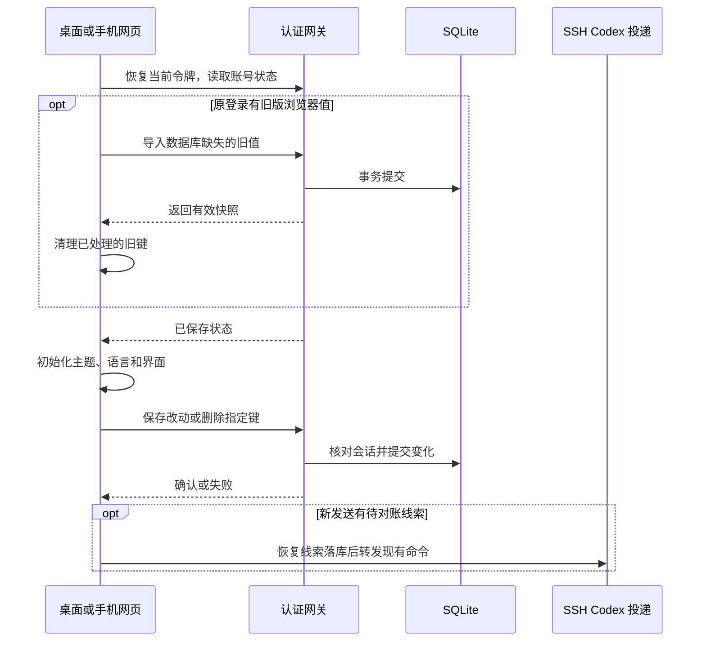

# 自托管 Web 账号状态

自托管 Web 只在浏览器持久化 `selfhost.auth` 登录令牌。桌面浏览器和手机网页在恢复有效登录后从同一网关数据库读取界面偏好及可恢复的工作区状态。页面运行时持有已加载的状态和未确认写入。一次性导航意图、窗口编辑器实例身份和临时界面状态随页面结束。设置页触发的 Codex 原生文件操作继续由对应 SSH 用户执行。

## 范围与所有者

| 界面与数据 | 展示和提交 | 持久化所有者 |
| --- | --- | --- |
| 常规、外观、桌宠、左下角菜单 | 共享 UI 的现有设置操作 | 网关按 Web 账号保存界面模式、主题、字号、代码预览、通知、桌宠与设置导航 |
| 界面语言 | 已登录界面使用 SettingService，首次渲染读取同一账号语言 | 既有 `zcode_settings` 的 `locale`、`localePreference` |
| 侧栏、资源管理器、工作台面板 | 现有布局与导航偏好读写 | 网关按账号保存，工作区键继续使用原有 identity |
| 对话输入、项目草稿、模型选择、输入与搜索历史 | 原有编辑和草稿恢复规则 | 网关按账号保存，工作区与项目作用域继续由现有编辑器定义 |
| 发起客户端身份、待确认投递线索 | 现有命令登记与对账 | 网关按当前网页登录会话保存，重载可恢复，同账号另一登录有独立的发起端。已接收输入仍由 Codex/Gateway 的投递协议认定 |

网关通过认证的 `GET` 和 `PATCH /api/selfhost/browser-state` 读取和修改 `zcode_browser_state`。每个账号只读自己的记录。值使用网关现有的加密服务。浏览器按键发送变化，SQLite 在事务中写入。同一个键使用服务端最后已提交的值。启动快照、写入和重试均使用发出请求的认证会话。退出或跨标签登录变更时，使用新页面重新加载账号内存。

旧版本数据只在升级后的首次有效登录恢复时导入当前账号。导入包含旧标签页记住的自动化页签。数据库已经存在的值和明确删除的键优先。导入经数据库确认后清理同源的旧应用键。用户重新填写账号密码创建新登录时，从数据库读取该账号的设置，清理此浏览器遗留的旧应用键。清理限于本产品的存储键。语言优先保留数据库已有偏好，旧浏览器语言只补没有任何语言记录的账号。

## 启动与保存顺序

启动读取或旧数据导入失败时可重试。运行中写入失败时保留当前页面的改动并提示重试，浏览器恢复网络时重新尝试。跨设备重新打开或刷新后读取已确认的数据。账号变化、读写大小限制、Cookie 和缓存响应仍沿用自托管认证边界。

## 验收

| 用例 | 操作与通过条件 |
| --- | --- |
| SH-STATE-MIGRATION | 用仍登录的旧浏览器启动。导入主题、桌宠、语言和带工作区身份的草稿。已有数据库值优先。首次失败保留待导入值，可重试，成功后本地仅剩令牌，标签临时存储清空产品键 |
| SH-STATE-ACCOUNT | 桌面修改主题、桌宠、显示及输入相关状态。使用同账号的独立手机上下文读回。另一账号有独立设置和草稿。退出时清理原账号内存 |
| SH-STATE-WRITES | 同账号的两次写入可更新不同键。二次导入不恢复已清除项。拒绝失效会话、登录令牌键、无效请求和超出限制的数据。重启后实际 SQLite 可恢复已确认状态 |
| SH-STATE-COMPOSER | 输入草稿刷新后恢复。命令登记未能持久化时保持原编辑内容。恢复网络后允许发送，沿用已有查回执与去重处理。桌面和手机网页使用同一持久化接口 |
| SH-STATE-STORAGE | 登录、打开工作区、操作设置和对话后核对真实浏览器存储。持久化浏览器 API 中只有自托管登录令牌 |

这组场景由自托管浏览器和隔离网关回归覆盖。原生桌面、Codex 文件作用域、已接收的命令及桌面远控的投递语义维持原实现。
