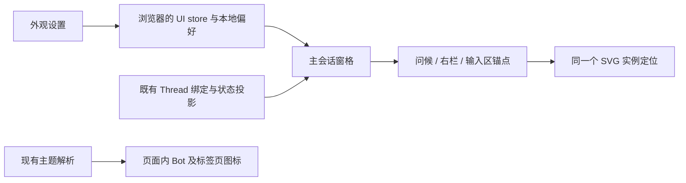

# Codex Web 品牌与会话桌宠

## 品牌入口

自托管浏览器标签页命名为 `Codex Web`。登录、连接、共享界面和会话输入里用于标识当前网页产品的文案统一使用 `Codex Web` 或语境明确的通用文案。上游归属、独立桌面客户端、外部服务和已有集成按实际对象命名。包、存储、协议、深链接和测试钩子沿用已发布的标识。

应用图标、启动画面、分享页以及思考和工作行使用同一个 Bot 的轮廓和镂空眼睛。页面内图标读取现有根主题，深色为白色，浅色为黑色。浏览器标签图标在启动脚本解析偏好后即可匹配，并随现有主题更新流程换色。桌面打包和通用 favicon 备用图标采用深色底座与同一个白色 Bot，以适配系统外壳。桌面打包和通用 favicon 备用图标采用深色底座与同一个白色 Bot，以适配系统外壳。

## 会话桌宠

- 自托管主会话默认显示桌宠。「设置 → 外观 → 桌宠」可关闭和重新开启。设置搜索使用同一标签定位此开关。偏好保存于本浏览器。关闭时空草稿只显示原问候和输入区，状态行的小图标继续显示。
- 新话题草稿的 Bot 位于问候上方，原有背景 Z 图案移除。输入文字及投递失败时仍跟随草稿。
- 草稿实际绑定到 Thread 后，同一实例从问候上方滑至会话右下方。直接打开历史话题时直接显示在右下方。已有状态栏占位时，桌宠在右栏底部。没有右栏时使用输入区右上方的紧凑位置；手机也采用紧凑位置。显示条件覆盖可交互主会话，屏蔽浮窗、子智能体详情和会话出错面板。
- 桌宠按已有会话投影表现待机或工作。思考和工作行保留原有标签、时长与点击操作。桌宠遵循减弱动态效果偏好，保持静态并即时定位。桌宠为装饰 SVG，随布局尺寸变化定位，避开可操作控件。
- 绘制参考 [GrokBot Animation Anatomy](https://github.com/ArvinYin1/grokbot-animation-anatomy/tree/debd41625da89b4c4fde43b3b1f0add6dc113c02) 的径向轮廓、贝塞尔关键帧、固定子步弹簧、球面眼睛正交投影与眨眼轨道。项目作者说明原版 Grok 的提取数据仅供研究。本实现使用自己的轮廓参数和 Clip。[bloub](https://github.com/jeremy-prt/bloub) 仅参考同一轮廓缩放到多个尺寸的做法。[OpenMausBot](https://github.com/milind-soni/OpenMausBot) 仅参考空态与运行状态行中的使用方式。

## 状态所有者与顺序

布局锚点由会话窗格提供。动画只读提交后的锚点，以最后一次实际绘制的位置为移动起点。动画生命周期属于渲染器。话题创建、远端事件、重连和历史恢复沿用 SessionPane 现有数据。

## 验收

| 用例 | 场景 | 断言 |
| --- | --- | --- |
| SH-BRAND-THEME | 首屏与运行后切换深色、浅色、系统主题；登录与工作区 | 标签名为 Codex Web，图标颜色跟随解析后的主题，DOM 中使用同一套 Bot 标识。 |
| SH-PET-DOCK | 桌面新话题，输入并发送，收到真实 Thread 绑定投影，再切回草稿 | 草稿无背景 Z。问候上方的 Bot 滑至右栏下方，位置相对输入栏不重叠。回草稿回到问候上方。 |
| SH-PET-COMPACT | 手机、窄窗、右栏收起，启用减弱动态效果 | Bot 放在紧凑锚点，保持输入与消息可用。减弱动态效果时直接落位。 |
| SH-PET-PREF | 搜索桌宠、默认、切换关、刷新、再开启 | 外观设置开关状态保留，关闭时无桌宠占位。 |
| SH-BOT-STATUS | 受控模型流返回思考与持续运行，再结束 | 两处状态图标使用 Bot，状态文本、时长和收起按钮原样工作。 |
