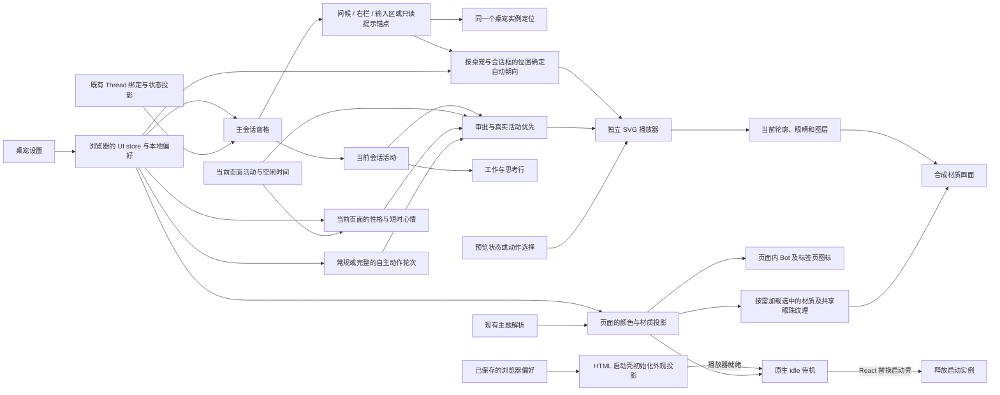

# Codex Web 品牌与会话桌宠

## 品牌入口

自托管浏览器标签页命名为 `Codex Web`。登录、连接、共享界面和会话输入里用于标识当前网页产品的文案统一使用 `Codex Web` 或语境明确的通用文案。上游归属、独立桌面客户端、外部服务和已有集成按实际对象命名。包、存储、协议、深链接和测试钩子沿用已发布的标识。

应用图标、启动画面、分享页以及思考和工作行使用同一个 Bot 的轮廓和眼睛。所有入口读取本浏览器的颜色与材质偏好，默认随主题使用浅色背景下的黑色或深色背景下的白色。浏览器标签图标保留参考播放器 `idle` 静帧的原始姿态、路径和已放大的视口。会话窗格依据真实活动编排 Anatomy 的原生状态，工作行使用这条活动序列。状态行按照实际 20 像素绘制并保留完整画布，展示进度环、雷达、笔迹等原生形变。状态行遵循减少动态效果偏好。桌面安装包和通用 favicon 文件为系统提供固定的备用图标。

HTML 启动壳从保存的偏好读取颜色和材质，立即以纯色播放轻微摆动。启用 Anatomy 的构建独立加载同一播放器，首帧就绪后进入原生 `idle` 待机循环，选用的材质在可用时加入。React 接管 DOM 时释放 HTML 启动实例，仍在等待初始化的画面继续使用待机动作。两段启动动画都遵循系统的减少动态效果偏好。

## 会话桌宠

- 自托管主会话默认显示桌宠。「设置 → 桌宠」为独立设置分区。设置搜索定位显示开关。会话桌宠的轮廓、颜色、大小、动作朝向、视线跟随、空闲动作、点击回应、性格和自主反应立即应用，偏好保存于本浏览器。已有偏好缺少性格或自主反应时，按好奇、开启读取。恢复默认会恢复全部桌宠偏好。
- 新话题草稿的 Bot 位于问候上方，原有背景 Z 图案移除。输入文字及投递失败时仍跟随草稿。
- 草稿实际绑定到 Thread 后，同一实例从问候上方滑至会话右下方。直接打开历史话题时直接显示在右下方。状态栏展开并占用右栏时，桌宠在右栏底部。窄窗、收起右栏和手机使用紧凑桌宠，在输入区上方独占一行并靠右对齐。
- 主会话在另一端持有写锁时仍显示桌宠。窄布局把紧凑桌宠放在底部只读提示上方的独立行。接收得到的活动由当前会话投影驱动，缺少活动时待机。输入权限、只读提示和重连由现有会话流程维护。浮窗、子智能体详情和会话订阅出错面板维持原来的显示规则。
- 动作朝向有随会话框位置、始终镜像、原始朝向三档，默认随位置。以桌宠为参照，会话框在左侧或左下方时左右镜像，在正下方或右侧时用原始朝向。裁决使用当前会话框与桌宠落点的几何位置。镜像后的视线仍朝指针的实际位置，动画播放器持续使用同一实例。
- 桌宠从当前会话投影读取待发送、推理、流式正文、工具运行与等待审批。审批优先于运行，搜索工具用雷达，读取、编辑、命令、子智能体分别使用各自的姿势。当前会话的这轮工作结束时播放一次完成或失败反应。打开历史时从待机开始。思考和工作行保留原有标签、时长与点击操作。
- 会话窗格以工作区身份与会话 ID 维护一条当前活动的播放序列。通用工作先以进度环回应，然后进入原有工作轨道池；运行命令时使用运行和进度；读文件与推理时加入观察表情；改代码在编码和笔迹之间切换。搜索保持雷达为主，持续输出保留完整输出轨道后可显示接收形变。新活动直接取得优先权，隐藏页面与减少动态效果会停止轮换。等确认与待机、点击、完成等仍由参考状态的真实转移和交互触发。
- 桌宠在真实活动的基础上可以自主做出短暂反应。好奇、活泼、沉稳三种性格决定反应间隔及动作权重。触碰或成功让它短时间开心，失败后更警觉。心情会自然恢复，性格记在浏览器偏好里。空闲时可能展示、哼唱、转身、翻标志或打盹，持续无人交互后进入睡眠。长时间工作时可能哼唱、点头、眯眼或露出疑惑，反应结束后接回实时会话动作。点击从对应表情中抽取，避免连续重复。
- 「全部自主动作」默认关闭。开启后，自主反应从 Anatomy 的 53 个原生状态加权抽取。一次播放结束后才将该状态移出当轮，播完一轮后重新抽取。空闲和持续工作共享这一轮，性格和心情仍影响选取权重。前台空闲的桌宠会小睡并自行醒来，继续本轮。实际发送、加载、排队、审批及会话切换优先，工作行继续使用真实活动投影。
- 新活动和切换会话立即取消旧反应。正在发送、加载、排队或等待确认时显示各自的状态。工作行保持真实活动。空闲动作关闭后停用空闲自主反应与睡眠，关闭自主反应后仍能收到实际活动和点击回应。后台页面与系统减少动态效果都会停止自主定时器，返回前台重新计时。性格和心情只影响桌宠，不读取消息正文或键盘内容，也不发起请求。
- 本机 4310 动作预览直接挂载 [GrokBot Animation Anatomy](https://github.com/ArvinYin1/grokbot-animation-anatomy/tree/debd41625da89b4c4fde43b3b1f0add6dc113c02) 的 SVG 播放器与配套状态和轨道。圆形身体、镂空眼睛、眼球投影、眨眼、鼠标跟随、贝塞尔与形变沿用该版本。站点安装脚本从同一个播放器渲染两色标签图标。
- 28 段原始轨道同时用于实际会话。53 个状态由轨道、表情、形变与转移规则组合而成。桌宠设置内的动作图鉴按参考项目的五组展示全部 53 个状态，说明每个状态在本应用中的自动、点击或手动试玩入口。卡片展示当前选定造型，选中后在同页播放，提供跳一下和重新播放。状态详情显示参考 ID 与所用原始轨道。减少动态效果启用时，会话中的桌宠保持静态并即时定位，用户仍可明确播放选择的预览。
- 原版圆形与动作延用固定版 Anatomy 的 SVG 播放器。其它造型使用同版本形状页的轮廓与每种造型的眼宽、眼高、眼距和高度偏移。经球面投影得到的眼睛沿轮廓射线落到身体内，和身体一起挤压、移动，保留参考引擎转到背面、眨眼和无脸形变时的可见性。造型按钮使用正脸。动作卡按参考陈列馆的 96 单位视口连续播放，离屏自动休眠。设置提供颜色预设、自选颜色与跟随主题。
- 「外观 → 材质」有纯色、绒毛和玻璃三档，默认纯色。已有偏好补齐纯色，恢复默认会恢复纯色和主题色。当前颜色和材质即时作用于所有品牌与桌宠实例，包括工作与思考行、外观造型小卡、动作图鉴、启动和登录画面、应用与分享标志、浏览器标签图标。形状、缩放、镜像和播放由各入口指定。桌宠显示开关控制会话桌宠的显隐。
- 绒毛和玻璃只在选用时加载对应的 WebGL2 材质模块。材质使用 [Open Bot Avatar](https://github.com/DominikScholz/open-bot-avatar/tree/646793af2c86604539e02faa344e9793ab2aefe8) 的身体和眼珠着色器，绒毛眼睛有眼窝与柔光，玻璃眼睛有折射和镜面高光。每只眼睛只在 Anatomy 当帧的原始轮廓内着色。身体、眼睛弧线、形变、图层和播放时钟均由同一个 Anatomy 播放器提供。相同材质和配色的实例共用着色纹理。快速切换时以最新偏好为准，加载期间及 WebGL2 不可用时使用当前颜色的纯色绘制。
- 参考仓库说明提取资料用于学习研究。本机预览通过 `node selfhost/prepare-bot-anatomy.mjs <已检出的参考仓库> <已构建的 Web 目录>` 装入固定版本。自托管构建可通过 `CODEX_WEB_BOT_ANATOMY=1` 选择在 Docker 构建阶段取同一固定版本。服务器无法访问 GitHub 时，构建上下文可提供 `selfhost/.anatomy-reference.tgz`，内含同一已检出的目录内容及其 `.git`。打包脚本校验固定提交及未修改的参考素材。参考素材保留在构建产物中。默认构建继续使用仓库的品牌 SVG。动画模块使用站点自己的静态资源路径。

## 状态所有者与顺序

布局锚点由会话窗格提供。动画只读提交后的锚点，以最后一次实际绘制的位置为移动起点。动画生命周期属于渲染器。话题创建、远端事件、重连和历史恢复沿用 SessionPane 现有数据。

## 会话动作覆盖

| 原始轨道 | 会话里的播放入口 |
| --- | --- |
| Idle A、B、D | 默认待机、倾听和唤醒 |
| Marketing A–D、Logo A–B、Rotation B | 安静一段时间后的展示、转身和翻转 |
| Blocked A、B、C | 等待审批、任务失败、入睡前打盹 |
| Working A–F | 搜索以外的工作、读取和命令运行 |
| Streaming A–C | 模型持续输出正文 |
| Done A、B、C | 完成任务和点击后的开心反应 |
| Bodymoves A、Rotation A、Rotation C | 点击后玩耍、庆祝和点头回应 |

## 验收

| 用例 | 场景 | 断言 |
| --- | --- | --- |
| SH-BRAND-THEME | 首屏与运行后切换深色、浅色、系统主题；登录与工作区 | 标签名为 Codex Web，图标颜色跟随解析后的主题，DOM 中使用同一套 Bot 标识。 |
| SH-BRAND-BOOT | 延迟 Web 主模块，分别以普通动效和减少动态效果打开页面 | 启动壳先可见，随后由原版播放器绘制 `idle`。普通动效下画面逐帧变化，减少动态效果时显示待机静帧。应用加载后启动壳移除。 |
| SH-PET-DOCK | 桌面新话题，输入并发送，收到真实 Thread 绑定投影，再切回草稿 | 草稿无背景 Z。问候上方的 Bot 滑至右栏下方，位置相对输入栏不重叠。回草稿回到问候上方。 |
| SH-PET-COMPACT | 手机、窄窗、右栏收起，在相同会话比较桌宠开关前后的输入区，再打开建议面板 | Bot 在输入区上方独占一行，关闭桌宠时收起这一行。建议面板覆盖桌宠且选项可点，输入与消息保持可用。减弱动态效果时直接落位。 |
| SH-PET-READONLY | 打开另一端持有写锁的主会话，再从状态栏打开子智能体详情 | 宽屏右栏或窄屏只读提示右上方可见桌宠。只读主会话仍显示历史和重连。子智能体详情无独立桌宠。 |
| SH-PET-PREF | 搜索桌宠，选颜色、造型、大小与行为，刷新，再开关及恢复默认 | 独立桌宠分区与搜索可达，偏好即时作用于会话并持久化，关闭时无桌宠占位。 |
| SH-BOT-STATUS | 受控模型流经过一般工作、思考、命令、写入，再结束 | 工作行实际绘制对应的原生状态与至少一个同场景变体，状态文本、时长和收起按钮原样工作。 |
| SH-BOT-MOTION | 用本机预览包打开新话题、移动鼠标、触发模型活动，然后打开动作预览 | 待机、眼睛、姿势随时间和鼠标连续变化。53 个状态与 28 段动作都可选且由参考播放器绘制，按顺序播放可覆盖 28 段。主题换色时沿用同一实例。 |
| SH-BOT-PRESENCE | 空闲、睡着、唤醒，输入草稿、点击，运行命令并完成 | 同一会话桌宠依次展示、转身、困倦，再醒来。点击与输入分别触发反应和倾听。真正的提交、工具与结束状态接管同一桌宠。 |
| SH-BOT-GALLERY | 桌面和手机打开状态图鉴并筛选，点击形变状态和表情状态 | 图鉴共 53 卡，五组正确。选中卡片可播放、弹跳、重播，并显示会话触发说明和原始轨道。 |
| SH-BOT-FACE | 查看全部 25 个造型按钮并逐帧播放非圆形桌宠 | 正脸展示两只完整的眼睛。播放时可见眼睛留在身体内，转身、闭眼和变成雷达等仍按原始动作表现。 |
| SH-BOT-PERSONALITY | 调整性格，在静置、长时间工作和等待确认之间切换，切回页面及启用减少动态效果 | 保存的性格与开关继续生效。自主动作有随机间隔和不同选择，工作行继续显示当前状态，新活动接管桌宠。隐藏和减少动态效果期间暂停自主反应。 |
| SH-BOT-FACING | 在草稿、右栏和紧凑布局切换，并在设置中选择三种朝向后刷新 | 朝向默认跟随会话框，手动朝向即时应用并保存，草稿下方的输入区使用原始方向。 |
| SH-BOT-ALL-ACTIONS | 开启全部自主动作，在持续工作中推进实际桌宠的自主反应计时，然后等待桌宠小睡 | 53 个原生状态在当轮各播放一次，新会话活动可中断自主播放。工作行持续显示当前活动，桌宠醒来后继续自主播放。 |
| SH-BOT-MATERIAL | 在桌面和手机设置依次选绒毛、玻璃、自选颜色，再刷新并恢复默认 | 纯色启动无需材质资源。选中材质才加载对应 WebGL2 模块。桌宠、所有设置示例、工作行、思考行、启动、品牌图标与标签图标共享当前外观。两种材质保留 Anatomy 眼睛路径，眼内像素分别显示绒毛眼窝与玻璃反光。切换时同一个播放器继续原动作，禁用 WebGL2 时按当前颜色显示纯色。 |

动作选择与触发条件参考 [VS Code Pets](https://github.com/tonybaloney/vscode-pets) 的候选状态、[oneko.js](https://github.com/adryd325/oneko.js) 的随机闲逛与休息，以及 [BongoCat](https://github.com/ayangweb/BongoCat) 的交互反馈。会话状态继续采用 [OpenMausBot](https://github.com/milind-soni/OpenMausBot#how-it-works) 的事件驱动思路。具体图形与片段沿用 Anatomy。
