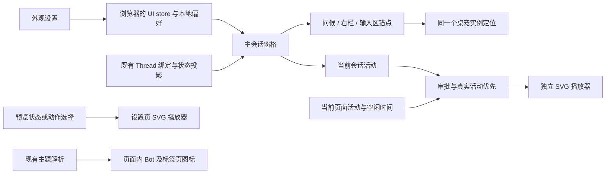

# Codex Web 品牌与会话桌宠

## 品牌入口

自托管浏览器标签页命名为 `Codex Web`。登录、连接、共享界面和会话输入里用于标识当前网页产品的文案统一使用 `Codex Web` 或语境明确的通用文案。上游归属、独立桌面客户端、外部服务和已有集成按实际对象命名。包、存储、协议、深链接和测试钩子沿用已发布的标识。

应用图标、启动画面、分享页以及思考和工作行使用同一个 Bot 的轮廓和镂空眼睛。页面内图标读取现有根主题，深色为白色，浅色为黑色。浏览器标签图标在启动脚本解析偏好后即可匹配，并随现有主题更新流程换色。桌面打包和通用 favicon 备用图标采用深色底座与同一个白色 Bot，以适配系统外壳。

## 会话桌宠

- 自托管主会话默认显示桌宠。「设置 → 外观 → 桌宠」可关闭和重新开启。设置搜索使用同一标签定位此开关。偏好保存于本浏览器。关闭时空草稿只显示原问候和输入区，状态行的小图标继续显示。
- 新话题草稿的 Bot 位于问候上方，原有背景 Z 图案移除。输入文字及投递失败时仍跟随草稿。
- 草稿实际绑定到 Thread 后，同一实例从问候上方滑至会话右下方。直接打开历史话题时直接显示在右下方。已有状态栏占位时，桌宠在右栏底部。没有右栏时使用输入区右上方的紧凑位置；手机也采用紧凑位置。显示条件覆盖可交互主会话，屏蔽浮窗、子智能体详情和会话出错面板。
- 桌宠从当前会话投影读取待发送、推理、流式正文、工具运行与等待审批。审批优先于运行，搜索工具用雷达，读取、编辑、命令、子智能体分别使用各自的姿势。当前会话的这轮工作结束时播放一次完成或失败反应。打开历史时从待机开始。思考和工作行保留原有标签、时长与点击操作。
- 安静时正常播放参考站待机动画。持续空闲时做展示、转身、翻转和打盹等动作，再进入睡眠。鼠标移动或键盘交互唤醒它，输入正文时切换到倾听，点击桌宠时依次触发好奇、玩耍、开心、吃惊等反应。会话的活动立即接管装饰动作，切换会话时取消上一会话的反应。只观察交互事件和当前投影，动画无需读取输入文字或发起请求。
- 本机 4310 动作预览直接挂载 [GrokBot Animation Anatomy](https://github.com/ArvinYin1/grokbot-animation-anatomy/tree/debd41625da89b4c4fde43b3b1f0add6dc113c02) 的 SVG 播放器与配套状态和轨道。圆形身体、镂空眼睛、眼球投影、眨眼、鼠标跟随、贝塞尔与形变沿用该版本。站点安装脚本从同一个播放器渲染两色标签图标。
- 28 段原始轨道同时用于实际会话。参考播放器轮换待机、工作和输出轨道，任务结果与点击触发完成、受阻和反应轨道，持续空闲触发展示和转身轨道，唤醒使用参考状态的过渡。「设置 → 外观 → 桌宠 → 动作预览」也可直接检查全部 53 个状态和 28 段轨道。减少动态效果启用时，会话中的桌宠保持静态并即时定位，设置页允许明确播放选定片段。
- 参考仓库说明提取资料用于学习研究。本机预览通过 `node selfhost/prepare-bot-anatomy.mjs <已检出的参考仓库> <已构建的 Web 目录>` 装入固定版本，素材与运行包保存在本机。常规构建继续使用仓库的品牌 SVG。预览包使用站点自己的静态资源路径。

## 状态所有者与顺序

布局锚点由会话窗格提供。动画只读提交后的锚点，以最后一次实际绘制的位置为移动起点。动画生命周期属于渲染器。话题创建、远端事件、重连和历史恢复沿用 SessionPane 现有数据。

## 会话动作覆盖

| 原始轨道 | 会话里的播放入口 |
| --- | --- |
| Idle A、B、D | 默认待机、倾听和唤醒 |
| Marketing A–D、Logo A–B、Rotation B | 安静一段时间后的展示、转身和翻转 |
| Blocked A、B、C | 等待审批、任务失败、入睡前打盹 |
| Working A–F | 搜索以外的工作、读取和命令运行 |
| Streaming A–C | 模型持续输出正文 |
| Done A、B、C | 完成任务和点击后的开心反应 |
| Bodymoves A、Rotation A、Rotation C | 点击后玩耍、庆祝和点头回应 |

## 验收

| 用例 | 场景 | 断言 |
| --- | --- | --- |
| SH-BRAND-THEME | 首屏与运行后切换深色、浅色、系统主题；登录与工作区 | 标签名为 Codex Web，图标颜色跟随解析后的主题，DOM 中使用同一套 Bot 标识。 |
| SH-PET-DOCK | 桌面新话题，输入并发送，收到真实 Thread 绑定投影，再切回草稿 | 草稿无背景 Z。问候上方的 Bot 滑至右栏下方，位置相对输入栏不重叠。回草稿回到问候上方。 |
| SH-PET-COMPACT | 手机、窄窗、右栏收起，启用减弱动态效果 | Bot 放在紧凑锚点，保持输入与消息可用。减弱动态效果时直接落位。 |
| SH-PET-PREF | 搜索桌宠、默认、切换关、刷新、再开启 | 外观设置开关状态保留，关闭时无桌宠占位。 |
| SH-BOT-STATUS | 受控模型流返回思考与持续运行，再结束 | 两处状态图标使用 Bot，状态文本、时长和收起按钮原样工作。 |
| SH-BOT-MOTION | 用本机预览包打开新话题、移动鼠标、触发模型活动，然后打开动作预览 | 待机、眼睛、姿势随时间和鼠标连续变化。53 个状态与 28 段动作都可选且由参考播放器绘制，按顺序播放可覆盖 28 段。主题换色时沿用同一实例。 |
| SH-BOT-PRESENCE | 空闲、睡着、唤醒，输入草稿、点击，运行命令并完成 | 同一会话桌宠依次展示、转身、困倦，再醒来。点击与输入分别触发反应和倾听。真正的提交、工具与结束状态接管同一桌宠。 |

活动信号与表演分开的做法参考 [OpenMausBot 的会话事件](https://github.com/milind-soni/OpenMausBot#how-it-works) 和 [dsh-pet 的状态优先级](https://github.com/ysyyhhh/dsh-pet)。空闲、打盹、唤醒的节奏参考 [Vibe Pet Monitor](https://github.com/7mouse/vibe-pet-monitor)；所有具体图形与片段仍来自 Anatomy。
