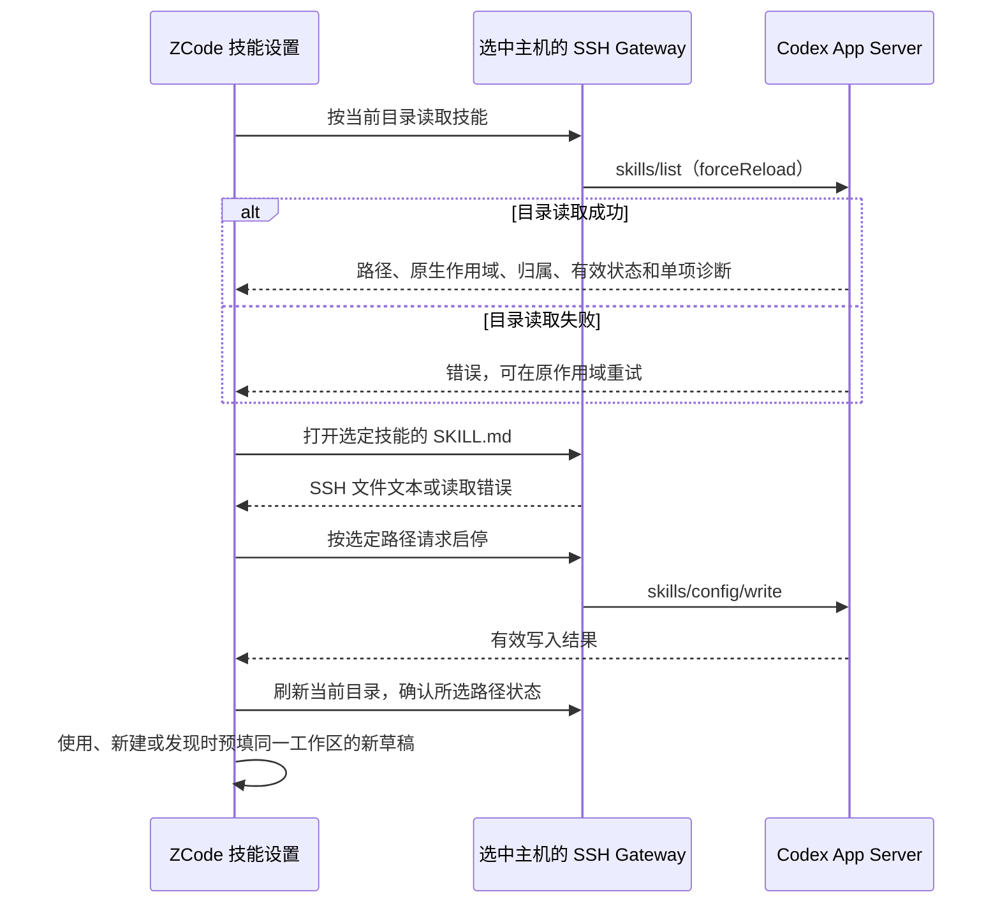

# SSH 技能设置与发现

设置的「技能」和插件设置的「技能」标签使用工作台选中的 SSH 设备和设置选中的工作目录。作用域菜单使用「当前 SSH 主机」标记这组用户和项目选项。刷新通过 Codex App Server 的 `skills/list` 重新扫描该目录。用户视图显示用户、内置、管理员和属于该作用域的插件技能。项目视图显示 Codex 在选定目录及其可发现的上级项目目录中归入 `repo` 的技能。插件归属以 Codex 返回的完整插件 ID 为准。用户级技能、项目技能和插件技能可以重名，路径按远端原始字符串区分。

自托管工作台打开单台 SSH 主机时，作用域菜单首层显示「用户」和该设备上可选择的项目。当前工作区排在项目列表前面，选择其他项目后相应项显示选中状态。项目较多时沿用项目列表的搜索和滚动。菜单复用设置作用域提供的目标和工作区 key，默认作用域、目录等待及连接状态由原有作用域模型处理。原生桌面的多设备设置继续使用各设备的「项目」子菜单。

列表显示原生界面名称和简短描述，未提供界面元数据时使用技能的原生名称和描述。搜索匹配两种名称、描述、来源和路径。打开条目可见原生技能名称、来源、绝对路径、状态和返回的工具依赖。打开路径在同一设置弹窗内预览选中 SSH 主机上的 `SKILL.md`，通过现有文件服务按大小上限读取 UTF-8 文本。读取失败保留条目和路径并允许重试。内容预览属于打开时的主机、目录和技能，关闭弹窗或切换目标后不显示迟到结果。

目录读取失败或响应格式无效时，当前作用域显示错误和重试入口。只有成功读取的当前目录才显示技能行或空提示。列表回调只更新发出请求时的作用域，切换主机或项目后丢弃迟到结果。原生扫描返回单项文件诊断时，错误详情与其余可用技能同时显示。

已启用技能的行内「使用」和详情「使用技能」打开同一条目的新草稿。已停用的技能只有详情与启用入口。「新建技能」和「发现技能」分别引用已启用的内置 `skill-creator` 和 `skill-installer`，通过同一个新任务入口预填选中工作区的聊天草稿。发现草稿要求列出可安装的技能。也可以在该草稿中指定精选技能或 GitHub 仓库路径，再发送给 Codex。插件分发的技能可从该主机的插件商店安装。打开、搜索、预填和刷新不执行安装或发送消息。

输入框的可用技能目录同样保留原生作用域和完整插件 ID，方便在选择时辨认内置、管理员和插件来源。同名选项仍以 `SKILL.md` 路径区分，投递保留原生技能名和所选路径。

启停使用原生 `skills/config/write` 按 `SKILL.md` 绝对路径写入远端 Codex 用户配置。保存报告和刷新后的列表均须反映请求的状态。项目覆盖或配置策略导致请求与回读不一致时提示失败，界面按回读事实展示。路径表示单项技能，即使配置项由远端 Codex 在用户配置中持久化，项目技能的启停也只作用于所选路径。写入后的活动引用目录从同一远端所有者刷新。

| 验收                | 操作                                                                                        | 通过条件                                                                                                                                   |
| ------------------- | ------------------------------------------------------------------------------------------- | ------------------------------------------------------------------------------------------------------------------------------------------ |
| SH-SKILL-SCOPES     | 在真实 App Server 中安装隔离测试插件并准备同名的用户、项目技能，再从桌面和手机进入设置      | 每个技能按原始路径出现于正确视图。内置和插件显示真实来源，原生显示名称和工具依赖可读。同名用户和项目技能各自保留。                         |
| SH-SKILL-SCOPE-MENU | 在桌面和手机展开当前 SSH 主机的技能作用域，目录包含十个以上项目，并从扩展中心打开另一个项目 | 首层可直接选用户和项目，当前工作区优先。可搜索和滚动该主机的项目，另一台主机的项目留在其工作台。其他项目的选择继续使用原有目录和草稿目标。 |
| SH-SKILL-FILE       | 打开技能详情和路径，搜索原生展示名称、路径或描述，刷新后重开                                | 详情读取远端文件正文，刷新显示原生元数据变更。文件不可读时保留详情和可重试的打开入口。                                                     |
| SH-SKILL-RETRY      | 让初次读取与后续刷新分别返回网关错误、无效响应，再恢复后重试                                | 当前作用域显示错误和重试入口。成功重试恢复技能和操作，错误期间不出现已安装为空的提示。                                                     |
| SH-SKILL-TARGET     | 在同一 SSH 主机的两个项目之间切换，并从另一个项目的技能行打开草稿                           | 迟到的扫描结果不进入当前列表。浏览器切到选中的项目目录，编辑器引用技能原始路径且草稿绑定选中的项目 ID。                                    |
| SH-SKILL-ENABLE     | 停用一个同名技能，重开设置，再恢复                                                          | 写入精确路径，另一项保持原状态。App Server 列表和隔离 `config.toml` 均确认生效。失败时反馈并保留真实状态。                                 |
| SH-SKILL-DISCOVER   | 在桌面和手机使用技能行内和详情动作，并体验新建与发现                                        | 已选择身份进入同一 SSH 工作区的草稿，只有用户发送后才调用，停用后的技能不提供使用入口。                                                    |

`node selfhost/tests/skill-settings-browser.mjs` 在 1480px 和 390px 下运行浏览器回归。脚本在隔离的 `HOME` 和 `CODEX_HOME` 中启动真实 App Server，通过测试网关调用它。可用 `SELFHOST_SKILL_CODEX_BIN` 指定原生版本，用 `SELFHOST_SKILL_SETTINGS_TEST_URL` 复用已有的自托管构建。

依据 [Codex App Server 技能协议](https://learn.chatgpt.com/docs/app-server#skills)、[Codex 技能目录与安装方式](https://learn.chatgpt.com/docs/build-skills#install-curated-skills-for-local-use)，以及 ZCode v4.0.0 的 [设置](https://github.com/zai-org/ZCode/blob/a4b4445141eb7d3b3e99eada9292775383bfc44e/packages/ui/src/SettingsPage.tsx)、[插件分区](https://github.com/zai-org/ZCode/blob/a4b4445141eb7d3b3e99eada9292775383bfc44e/packages/ui/src/settings/PluginsSection.tsx)、[技能分区](https://github.com/zai-org/ZCode/blob/a4b4445141eb7d3b3e99eada9292775383bfc44e/packages/ui/src/settings/SkillsSection.tsx)和[技能导入](https://github.com/zai-org/ZCode/blob/a4b4445141eb7d3b3e99eada9292775383bfc44e/packages/ui/src/settings/ExternalAgentImportDialog.tsx)。
